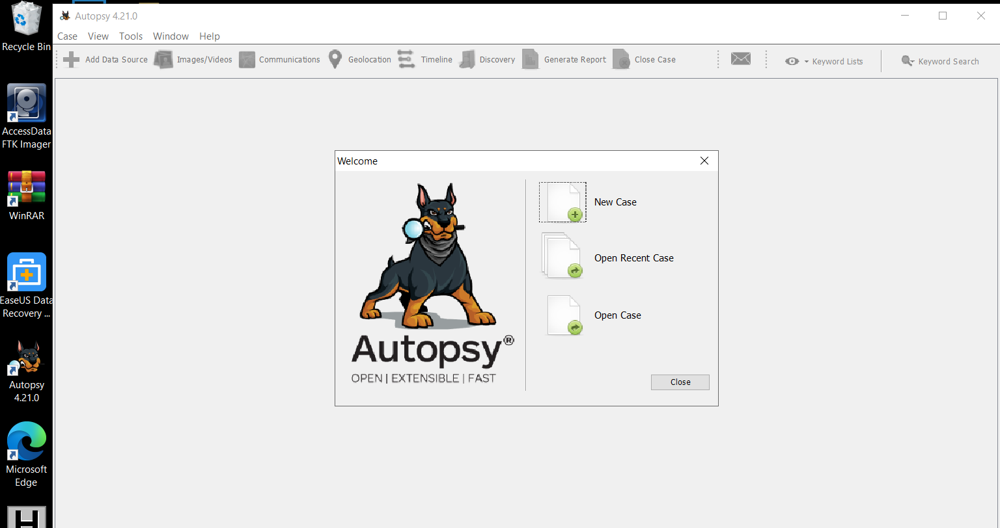
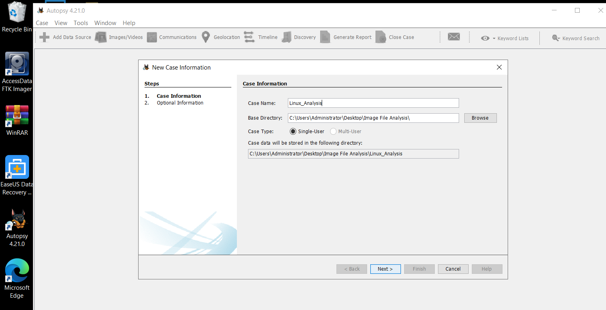
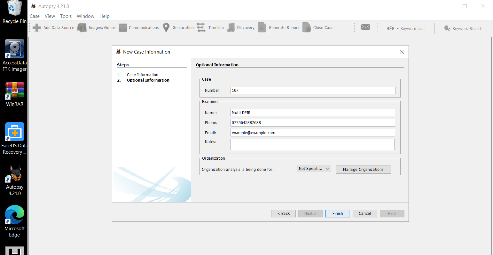
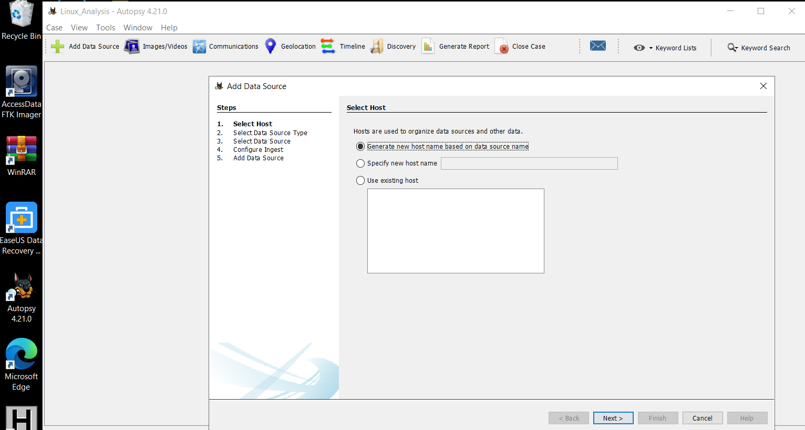
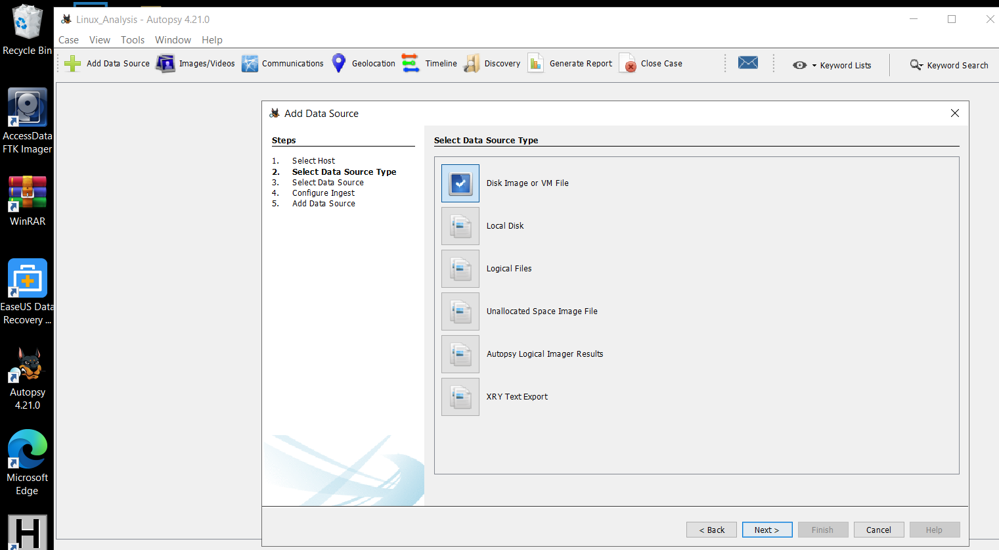
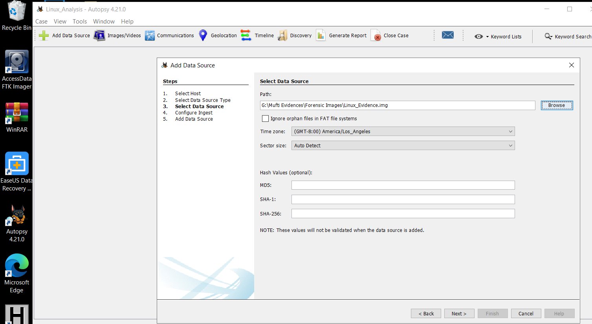
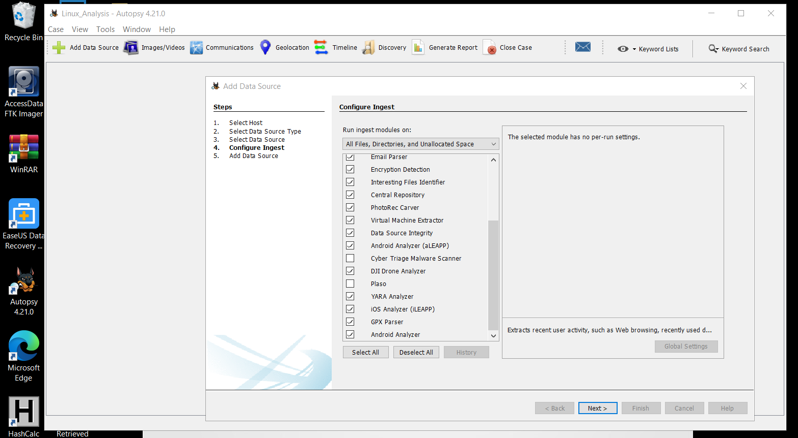
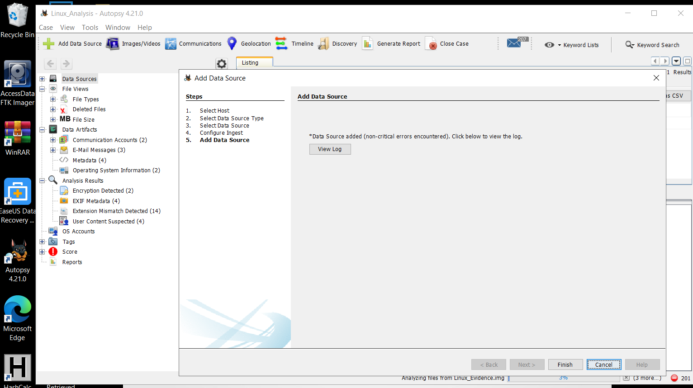
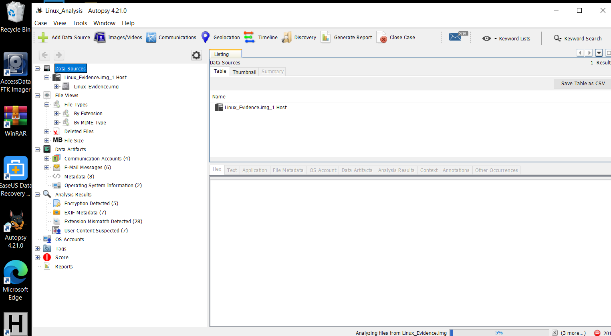

# 🔎 Autopsy — Digital Forensic Disk Image Examination

| Metadata | Details |
| :--- | :--- |
| **DFIR Domain** | Dead-Box Disk Image Acquisition & File System Forensics |
| **Evidence Image** | `Linux_Evidence_001.img` |
| **Case Identifier** | Case `1001-101` |
| **Forensic Tooling** | Autopsy Digital Forensics Platform (The Sleuth Kit) |

---

## 🎯 1. Scenario & Objective

During a criminal investigation, a powered-off workstation was seized from the scene and brought to the Digital Forensics laboratory, where a bit-stream forensic disk image (`Linux_Evidence_001.img`) was acquired.

**Objective:** Conduct a structured forensic examination in **Autopsy**—configuring case metadata, chain-of-custody examiner identifiers, data source ingestion modules, and file system artifact trees to identify evidentiary files.

---

## 🛠️ 2. Examination Procedure & Annotated Evidence

### Step 1: Initializing the Forensic Case
Launched Autopsy and initiated a **New Case** from the welcome console.

---

### Step 2: Case Metadata & Examiner Attribution
Entered the mandatory case directory structure and examiner details (**Case Number:** `1001-101`).

---

### Step 3: Host & Data Source Selection
Configured host allocation and selected **Disk Image or VM File** as the forensic input source.

---

### Step 4: Mounting the Forensic Disk Image (`Linux_Evidence_001.img`)
Attached the raw forensic disk image and validated sector/timezone parameters.

---

### Step 5: Configuring Automated Ingest Modules
Enabled Autopsy ingest modules (Recent Activity, Hash Lookup, File Type Identification, Extension Mismatch Detector, Embedded File Extractor, Keyword Search, and Correlation Engine).

---

### Step 6: File System & Partition Tree Analysis
Expanded **Data Sources** → `Linux_Evidence_001.img_1` to inspect allocated files, deleted inodes, MACB timestamps, and hex/strings views.

