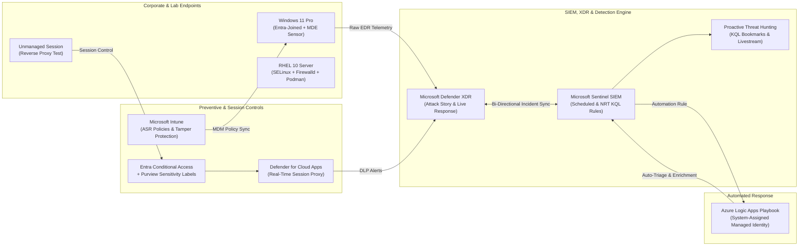

# 🛡️ Muftaw Wahab Ayinla
### **Security Operations Analyst (SOC) • Detection Engineer • Digital Forensics (DFIR) • Linux Systems Administrator**

*Hands-on threat detection, incident triage, cloud SIEM/XDR engineering, Windows forensic analysis, and enterprise Linux hardening.*

---

## 👨‍💻 Executive Profile

I am a cybersecurity practitioner specializing in **Security Operations (SOC), Incident Response, Detection Engineering, Digital Forensics (DFIR), and Linux Infrastructure Administration**. I hold an **MSc in Cybersecurity from Liverpool John Moores University (UK)** and serve as **Founder & Lead Instructor at Muftinet IT Training Centre**.

Every project and case study on this profile represents **verifiable, hands-on engineering work** executed in live cloud and virtualized lab environments—complete with custom **KQL detection rules**, **PowerShell adversary simulations**, **Azure Logic Apps SOAR workflows**, **RHEL 10 security baselines**, and **Windows forensic artifact investigations**.

> *"No badges for tools I haven't used. No claims without verifiable configurations, queries, and evidence."*

---

## 🧰 Core Technical Stack & Security Platforms

| Domain | Platforms, Tools & Languages |
| :--- | :--- |
| **SIEM & XDR Operations** |    -0078D4?style=flat-square&logo=microsoft&logoColor=white) |
| **Identity & Data Governance** |     |
| **Query, Scripting & SOAR** | -0089D6?style=flat-square&logo=microsoftazure&logoColor=white)    -0078D4?style=flat-square&logo=microsoftazure&logoColor=white) |
| **Digital Forensics (DFIR)** | -1E293B?style=flat-square)    |
| **Linux & Network Defense** | -EE0000?style=flat-square&logo=redhat&logoColor=white)    |

---

## 🏗️ Enterprise Cloud SOC & DFIR Lab Architecture

---

## 📌 Flagship Engineering Suites

| Engineering Suite | Focus Area | Key Deliverables |
| :--- | :--- | :--- |
| 🛡️ **[`microsoft-soc-xdr-sentinel-labs`](https://github.com/mufticyberpro/microsoft-soc-xdr-sentinel-labs)** | **Microsoft SOC, Sentinel SIEM & Defender XDR** | 7 end-to-end SOC engineering case studies, production KQL hunting/analytics queries, benign PowerShell adversary simulations (LOLBAS/Encoded PS/Persistence), and Managed Identity SOAR playbooks. |
| 🐧 **[`linux-administration-and-hardening`](https://github.com/mufticyberpro/linux-administration-and-hardening)** | **RHEL 10 Linux Administration & Hardening (RHCSA)** | 62 hands-on RHEL 10 engineering labs across 11 modules: SELinux mandatory access control, `firewalld`, LVM/Stratis storage, `autofs`, `systemd`, Podman Quadlets, plus automated provisioning & grading scripts. |
| 🔎 **[`windows-dfir-forensics-labs`](https://github.com/mufticyberpro/windows-dfir-forensics-labs)** | **Windows Digital Forensics & Incident Response (DFIR)** | Deep-dive forensic playbooks and artifact investigations: Program Execution (`Prefetch`, `Amcache`, `Shimcache`, `SRUM`), Registry transaction logs, Event Log lateral movement, NTFS `$MFT`/`$UsnJrnl`, USB tracking, Browser/Cloud forensics, and Autopsy disk examinations. |

---

## 🧪 Featured SOC & Detection Engineering Case Studies

1. **[Case Study 01 — Endpoint Hardening, Intune ASR Deployment & Tamper Protection](https://github.com/mufticyberpro/mufticyberpro/blob/main/microsoft-soc-xdr-sentinel-labs/case-studies/01_Endpoint_Hardening_and_ASR.md)**
   * *MITRE ATT&CK:* `T1003.001` (LSASS Memory), `T1027` (Obfuscated Files), `T1562.001` (Disable or Modify Tools)
   * *Summary:* Deployed Intune Attack Surface Reduction rules protecting `lsass.exe` and blocking Office child processes, enforced Tamper Protection, and validated `EventID 1121/1122` locally via PowerShell and in Defender XDR via `DeviceEvents`.
2. **[Case Study 02 — Incident Triage, Attack Story Analysis & Live Response Containment](https://github.com/mufticyberpro/mufticyberpro/blob/main/microsoft-soc-xdr-sentinel-labs/case-studies/02_Incident_Triage_and_LiveResponse.md)**
   * *MITRE ATT&CK:* `T1105` (Ingress Tool Transfer), `T1059.001` (PowerShell)
   * *Summary:* Executed safe LOLBAS (`certutil.exe`) and Base64-encoded PowerShell telemetry simulations; triaged the parent-child process tree in Defender XDR, collected volatile forensic metadata via **Live Response**, and evaluated **Selective vs. Full Isolation**.
3. **[Case Study 03 — Enterprise SIEM Deployment & Bi-Directional Defender XDR Synchronization](https://github.com/mufticyberpro/mufticyberpro/blob/main/microsoft-soc-xdr-sentinel-labs/case-studies/03_Sentinel_SIEM_and_XDR_Integration.md)**
   * *Focus:* SIEM/XDR Architecture, Telemetry Streaming, `SentinelHealth` Monitoring
   * *Summary:* Deployed Microsoft Sentinel on Log Analytics, configured bi-directional incident synchronization with Defender XDR, ingested raw endpoint & Entra ID sign-in tables (`DeviceProcessEvents`, `SigninLogs`), and implemented `SentinelHealth` drift monitoring.
4. **[Case Study 04 — Detection Engineering: Custom KQL Scheduled & NRT Analytics Rules](https://github.com/mufticyberpro/mufticyberpro/blob/main/microsoft-soc-xdr-sentinel-labs/case-studies/04_Detection_Engineering_KQL_Analytics.md)**
   * *MITRE ATT&CK:* `T1105` (Ingress Tool Transfer), `T1059.001` (Encoded PowerShell)
   * *Summary:* Authored custom Scheduled and 60-second Near-Real-Time (NRT) KQL analytics rules with **Host/Account Entity Mapping** and **2-Hour Alert Grouping** to populate the Sentinel Investigation Graph while eliminating alert fatigue.
5. **[Case Study 05 — Zero-Trust SOAR Engineering with Azure Logic Apps & Managed Identity](https://github.com/mufticyberpro/mufticyberpro/blob/main/microsoft-soc-xdr-sentinel-labs/case-studies/05_SOAR_Playbooks_Managed_Identity.md)**
   * *Focus:* Security Orchestration, Automation, and Response (SOAR) & Azure RBAC
   * *Summary:* Built an automated incident triage workflow combining Sentinel Automation Rules with an Azure Logic App Playbook authenticated via **System-Assigned Managed Identity** (`Microsoft Sentinel Responder`), eliminating hardcoded secrets.
6. **[Case Study 06 — Hypothesis-Driven Threat Hunting, KQL Bookmarks & Sentinel Livestream](https://github.com/mufticyberpro/mufticyberpro/blob/main/microsoft-soc-xdr-sentinel-labs/case-studies/06_Proactive_Threat_Hunting_KQL.md)**
   * *Focus:* Least-Frequency-of-Occurrence (LFO) Hunting, Regex Payload Extraction, Cross-Table Joins
   * *Summary:* Conducted proactive hunts across endpoint, network, and email tables (`EmailAttachmentInfo` → `DeviceProcessEvents`), documented evidence in **Sentinel Hunting Bookmarks**, monitored active threats via **Livestream**, and escalated findings to incidents.
7. **[Case Study 07 — Cloud SaaS DLP: Microsoft Purview Sensitivity Labels & MDCA Session Control](https://github.com/mufticyberpro/mufticyberpro/blob/main/microsoft-soc-xdr-sentinel-labs/case-studies/07_Purview_DLP_and_MDCA_Session_Control.md)**
   * *Focus:* Data Loss Prevention (DLP), CASB Reverse Proxy (`*.mcas.ms`), Zero-Trust Session Control
   * *Summary:* Integrated Microsoft Purview Sensitivity Labels with Entra Conditional Access and Defender for Cloud Apps to allow in-browser viewing while blocking real-time downloads of confidential files on unmanaged (BYOD) devices.

---

## 🔎 Featured Digital Forensics (DFIR) & Linux Hardening Playbooks

- **[DFIR Playbook 01 — Program Execution, Persistence & Resource Usage (`Prefetch`, `Amcache`, `Shimcache`, `SRUM`)](https://github.com/mufticyberpro/mufticyberpro/blob/main/windows-dfir-forensics-labs/investigations/01_Program_Execution_and_Persistence_Forensics.md)**
- **[DFIR Playbook 02 — Windows Event Log Correlation & RDP Lateral Movement Triage](https://github.com/mufticyberpro/mufticyberpro/blob/main/windows-dfir-forensics-labs/investigations/02_Event_Log_and_Lateral_Movement_Investigation.md)**
- **[DFIR Playbook 03 — Registry Hives, Dirty Log Replay, Shellbags, `.LNK` & USB Device Tracking](https://github.com/mufticyberpro/mufticyberpro/blob/main/windows-dfir-forensics-labs/investigations/03_Registry_Hives_USB_and_User_Activity.md)**
- **[DFIR Playbook 04 — NTFS `$MFT` vs. `$FILE_NAME` Timestomping Detection & `$UsnJrnl` Recovery](https://github.com/mufticyberpro/mufticyberpro/blob/main/windows-dfir-forensics-labs/investigations/04_NTFS_MFT_UsnJrnl_and_Timestomp_Analysis.md)**
- **[DFIR Playbook 05 — Browser SQLite + WAL Forensics, `:Zone.Identifier` ADS & Cloud Sync Analysis](https://github.com/mufticyberpro/mufticyberpro/blob/main/windows-dfir-forensics-labs/investigations/05_Browser_Cloud_Storage_and_Email_Forensics.md)**
- **[DFIR Case Examination — Autopsy Dead-Box Forensic Disk Image Analysis (with Screenshots)](https://github.com/mufticyberpro/mufticyberpro/blob/main/Labs/Digital_Forensics_and_DFIR/Autopsy_Forensic_Examination/README.md)**
- **[Enterprise RHEL 10 Linux Security Hardening — SELinux, Firewalld, LVM2, Autofs & Podman (62 Labs)](https://github.com/mufticyberpro/mufticyberpro/blob/main/linux-administration-and-hardening/README.md)**

---

## 🎓 Education, Leadership & Certifications

- 🎓 **MSc in Cybersecurity** — *Liverpool John Moores University, United Kingdom*
- 🏫 **Founder & Lead Instructor** — *Muftinet IT Training Centre (Ghana)*
- 💼 **Managing Director** — *Muftinet IT Solutions (Enterprise IT & Security Deployments)*
- 📜 **Active Certification Tracks:**
  - **Microsoft Certified: Security Operations Analyst Associate (SC-200)**
  - **GIAC Certified Forensic Examiner (GCFE / SANS FOR500 Windows Forensics)**
  - **Red Hat Certified System Administrator (RHCSA — EX200 on RHEL 10)**

---

## 📊 GitHub Activity & Contribution Metrics

  
  

---

## 📫 Contact & Recruitment

I am actively open to **SOC Analyst (Tier 1 / Tier 2), Detection Engineer, DFIR Analyst, and Cloud Security Operations** opportunities.

- 📧 **Email:** [mufticyberpro@gmail.com](mailto:mufticyberpro@gmail.com)
- 🔗 **LinkedIn:** [linkedin.com/in/muftaw-wahab-ayinla](https://linkedin.com/in/muftaw-wahab-ayinla)

<i>"Security is not a product, but a process." — Bruce Schneier</i>

