# 🐧 Enterprise Linux Administration & Security Hardening Suite (RHEL 10)

> **Author:** Muftaw Wahab Ayinla (MSc Cybersecurity)  
> **Target Platform:** Red Hat Enterprise Linux 10 (RHEL 10) • SELinux • `firewalld` • `systemd` • LVM2 • Rootless Podman

---

## 📌 Executive Overview

This repository contains **62 hands-on Linux system administration, storage engineering, and security hardening labs** organized across **11 modular domains** on **Red Hat Enterprise Linux 10 (RHEL 10)**, accompanied by automated Bash environment provisioning (`scripts/setup-lab.sh`) and automated compliance verification (`scripts/grade-exam.sh`).

Every module includes:
- **Idempotent Environment Setup Blocks** (`Setup`) to initialize test users, loop/LVM block devices, and broken service states.
- **Production Engineering Solutions** (`SOLUTIONS.md`) using native RHEL 10 utilities (`nmcli`, `semanage`, `firewall-cmd`, `lvextend`, `podman`).
- **Automated Verification Checks** (`Verify`) to validate persistent across-reboot configurations (`/etc/fstab`, `semanage fcontext`, `systemd` unit files).

---

## 🏗️ Enterprise RHEL 10 Hardening & Administration Architecture

```mermaid
flowchart LR
    subgraph Access["Identity & Access Control"]
        Users["Users, Groups & Sudoers<br/>(UID/GID, Aging, ACLs, SGID)"]
        SSH["OpenSSH Hardening<br/>(Key Auth, Root Block)"]
    end

    subgraph MAC_Net["Mandatory Access & Network Defense"]
        SEL["SELinux Enforcing<br/>(fcontext, port, booleans)"]
        FW["Firewalld Zones & Rich Rules<br/>(firewall-cmd --permanent)"]
    end

    subgraph Storage["Storage & Filesystems"]
        LVM["LVM2 Volume Management<br/>(PV, VG, LV, XFS/ext4, Swap)"]
        Auto["NFS & Autofs<br/>(Indirect Wildcard Maps)"]
    end

    subgraph Runtime["Services & Containers"]
        Sys["Systemd & Tuned<br/>(Targets, Timers, rsyslog, chrony)"]
        Pod["Rootless Podman & Quadlet<br/>(Systemd Container Units)"]
    end

    Access --> MAC_Net --> Storage --> Runtime
```

---

## 📂 Hands-On Engineering Modules (62 Labs)

| Module | Domain Focus | Labs Count | Lab Specifications | Implementation & Verification |
| :---: | :--- | :---: | :--- | :--- |
| **01** | **Essential System Tools & ACLs** | 11 | [`labs/01-Essential-Tools/LABS.md`](./labs/01-Essential-Tools/LABS.md) | [`SOLUTIONS.md`](./labs/01-Essential-Tools/SOLUTIONS.md) |
| **02** | **Software Management (DNF, RPM & Flatpak)** | 4 | [`labs/02-Manage-Software-RPM-Flatpak/LABS.md`](./labs/02-Manage-Software-RPM-Flatpak/LABS.md) | [`SOLUTIONS.md`](./labs/02-Manage-Software-RPM-Flatpak/SOLUTIONS.md) |
| **03** | **Bash Automation & Shell Scripting** | 4 | [`labs/03-Shell-Scripting/LABS.md`](./labs/03-Shell-Scripting/LABS.md) | [`SOLUTIONS.md`](./labs/03-Shell-Scripting/SOLUTIONS.md) |
| **04** | **Operating Running Systems (`systemd`, Boot Recovery, Logging)** | 10 | [`labs/04-Operate-Running-Systems/LABS.md`](./labs/04-Operate-Running-Systems/LABS.md) | [`SOLUTIONS.md`](./labs/04-Operate-Running-Systems/SOLUTIONS.md) |
| **05** | **Local Storage Engineering (GPT, LVM2, Swap)** | 6 | [`labs/05-Configure-Local-Storage-LVM/LABS.md`](./labs/05-Configure-Local-Storage-LVM/LABS.md) | [`SOLUTIONS.md`](./labs/05-Configure-Local-Storage-LVM/SOLUTIONS.md) |
| **06** | **Filesystems, NFS Mounts & `autofs`** | 5 | [`labs/06-Create-Configure-Filesystems-Autofs/LABS.md`](./labs/06-Create-Configure-Filesystems-Autofs/LABS.md) | [`SOLUTIONS.md`](./labs/06-Create-Configure-Filesystems-Autofs/SOLUTIONS.md) |
| **07** | **System Deployment, `cron`/`systemd` Timers & `chrony`** | 6 | [`labs/07-Deploy-Configure-Maintain-Systems/LABS.md`](./labs/07-Deploy-Configure-Maintain-Systems/LABS.md) | [`SOLUTIONS.md`](./labs/07-Deploy-Configure-Maintain-Systems/SOLUTIONS.md) |
| **08** | **Network Configuration (`nmcli`, Hostnames, Static Routes)** | 4 | [`labs/08-Manage-Basic-Networking/LABS.md`](./labs/08-Manage-Basic-Networking/LABS.md) | [`SOLUTIONS.md`](./labs/08-Manage-Basic-Networking/SOLUTIONS.md) |
| **09** | **Identity, Group Collaboration (SGID) & `sudo` Policy** | 4 | [`labs/09-Manage-Users-and-Groups/LABS.md`](./labs/09-Manage-Users-and-Groups/LABS.md) | [`SOLUTIONS.md`](./labs/09-Manage-Users-and-Groups/SOLUTIONS.md) |
| **10** | **Security Hardening: SELinux & `firewalld`** | 8 | [`labs/10-Manage-Security-SELinux-Firewall/LABS.md`](./labs/10-Manage-Security-SELinux-Firewall/LABS.md) | [`SOLUTIONS.md`](./labs/10-Manage-Security-SELinux-Firewall/SOLUTIONS.md) |
| **11** | **Rootless Containers with Podman & Systemd Quadlets** | Bonus | [`labs/11-Manage-Containers-Podman/LABS.md`](./labs/11-Manage-Containers-Podman/LABS.md) | [`SOLUTIONS.md`](./labs/11-Manage-Containers-Podman/SOLUTIONS.md) |

---

## 🛠️ Automated Lab Provisioning & Compliance Auditing (`scripts/`)

1. **[`scripts/setup-lab.sh`](./scripts/setup-lab.sh):** Initializes loop devices, mock repositories, and baseline system state on a clean RHEL 10 virtual machine.
2. **[`scripts/grade-exam.sh`](./scripts/grade-exam.sh):** Automated Bash compliance auditing engine that inspects SELinux contexts, active firewalld rules, LVM Logical Volume sizes, `/etc/fstab` UUID persistence, and systemd unit states.

