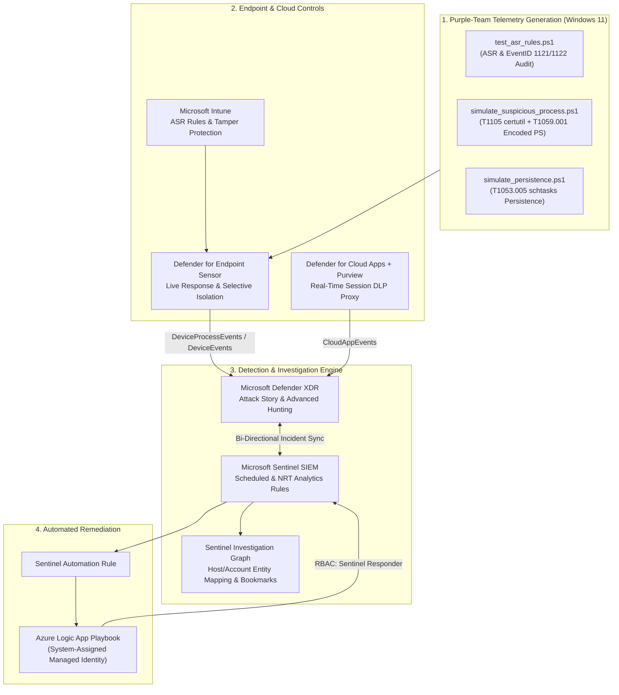

# 🛡️ Microsoft SOC, Detection Engineering, Defender XDR & Sentinel Case Studies

[](#)
[](#)
[](#)
[](#)
[](#)

> **Author:** Muftaw Wahab Ayinla (MSc Cybersecurity)  
> **Lab Environment:** Microsoft Entra ID • Windows 11 Enterprise/Pro • Microsoft Intune • Microsoft Defender XDR • Microsoft Sentinel • Azure Logic Apps • Microsoft Purview

---

## 📌 Overview

This repository documents **7 end-to-end Security Operations Center (SOC) & Detection Engineering case studies** built in a live Microsoft Cloud + Windows 11 environment. Rather than theoretical notes, each case study implements the complete detection and incident response lifecycle:

1. **Preventive Hardening & Policy Engineering** (Intune ASR, Tamper Protection, Purview Sensitivity Labels, Conditional Access App Control).
2. **Safe Purple-Team Adversary Telemetry Generation** (`PowerShell` scripts simulating LOLBAS ingress, Base64 obfuscation, and Scheduled Task persistence).
3. **Detection Engineering** (Custom Scheduled & Near-Real-Time KQL analytics rules with Entity Mapping and Alert Grouping).
4. **Triage, Live Response & Containment** (Attack Story correlation, remote shell forensics, Selective Isolation).
5. **Zero-Trust SOAR Automation** (Sentinel Automation Rules + Azure Logic Apps authenticated via System-Assigned Managed Identity).

---

## 🗺️ Architecture Diagram



---

## 📂 Case Studies Index

| # | Case Study Report | MITRE ATT&CK Mapping | Core Technologies |
| :---: | :--- | :--- | :--- |
| **01** | **[Endpoint Hardening, Intune ASR Deployment & Tamper Protection](./case-studies/01_Endpoint_Hardening_and_ASR.md)** | `T1003.001` (LSASS Memory)<br/>`T1027` (Obfuscated Scripts)<br/>`T1562.001` (Disable Tools) | Microsoft Intune, MDE, PowerShell (`Get-MpPreference`), KQL (`DeviceEvents`) |
| **02** | **[Incident Triage, Attack Story Correlation & Live Response Containment](./case-studies/02_Incident_Triage_and_LiveResponse.md)** | `T1105` (Ingress Tool Transfer)<br/>`T1059.001` (PowerShell) | Defender XDR Attack Story, Device Timeline, Live Response CLI, Selective Isolation |
| **03** | **[Enterprise SIEM Deployment & Bi-Directional Defender XDR Sync](./case-studies/03_Sentinel_SIEM_and_XDR_Integration.md)** | Enterprise Telemetry & Health Monitoring | Microsoft Sentinel, Log Analytics, Defender XDR Connector, Entra ID Logs, `SentinelHealth` |
| **04** | **[Detection Engineering: Custom Scheduled & NRT KQL Analytics Rules](./case-studies/04_Detection_Engineering_KQL_Analytics.md)** | `T1105` (Ingress Tool Transfer)<br/>`T1059.001` (Encoded Command) | Sentinel Analytics Engine, NRT Rules, Entity Mapping, Alert Grouping, Investigation Graph |
| **05** | **[Zero-Trust SOAR Playbooks with Azure Logic Apps & Managed Identity](./case-studies/05_SOAR_Playbooks_Managed_Identity.md)** | Automated Incident Triage & Enrichment | Sentinel Automation Rules, Azure Logic Apps, System-Assigned Managed Identity, Azure RBAC |
| **06** | **[Proactive Threat Hunting, KQL Regex Extraction & Sentinel Livestream](./case-studies/06_Proactive_Threat_Hunting_KQL.md)** | `T1105`, `T1059.001`, `T1566.001` (Spearphishing Attachment) | KQL Stack Counting (LFO), Multi-Table `inner join`, Hunting Bookmarks, Sentinel Livestream |
| **07** | **[Cloud SaaS DLP: Purview Sensitivity Labels & MDCA Session Control](./case-studies/07_Purview_DLP_and_MDCA_Session_Control.md)** | `T1530` (Data from Cloud Storage) | Microsoft Purview Information Protection, Entra Conditional Access, Defender for Cloud Apps (`*.mcas.ms`) |

---

## 🛠️ Repository Structure

```text
microsoft-soc-xdr-sentinel-labs/
├── README.md
├── case-studies/
│   ├── 01_Endpoint_Hardening_and_ASR.md
│   ├── 02_Incident_Triage_and_LiveResponse.md
│   ├── 03_Sentinel_SIEM_and_XDR_Integration.md
│   ├── 04_Detection_Engineering_KQL_Analytics.md
│   ├── 05_SOAR_Playbooks_Managed_Identity.md
│   ├── 06_Proactive_Threat_Hunting_KQL.md
│   └── 07_Purview_DLP_and_MDCA_Session_Control.md
├── queries/
│   └── hunting_queries.kql                  # 7 Production KQL Hunting & Analytics Queries
├── simulations/
│   ├── test_asr_rules.ps1                   # Local ASR GUID mapper, Tamper check & EventID 1121/1122 parser
│   ├── simulate_suspicious_process.ps1      # Safe LOLBAS certutil + Base64 PowerShell telemetry generator
│   └── simulate_persistence.ps1             # Safe Scheduled Task (schtasks.exe) persistence generator
└── screenshots/
    └── README.md                            # Organized evidence directory for lab execution screenshots
```

---

## 🔍 Quick Preview: Production KQL & Simulation Tooling

### 1. Extracting Base64-Encoded PowerShell Payloads (`queries/hunting_queries.kql`)
```kql
DeviceProcessEvents
| where TimeGenerated >= ago(7d)
| where FileName in~ ("powershell.exe", "pwsh.exe")
| where ProcessCommandLine has_any ("-e ", "-enc ", "-encodedcommand ", "-ec ")
| extend ExtractedBase64 = extract(@"-(?:e|enc|encodedcommand|ec)\s+([A-Za-z0-9+/=]+)", 1, ProcessCommandLine)
| project TimeGenerated, DeviceName, AccountName, ProcessCommandLine, ExtractedBase64, InitiatingProcessFileName
| sort by TimeGenerated desc
```

### 2. Local ASR Policy & Event ID 1121/1122 Verification (`simulations/test_asr_rules.ps1`)
```powershell
# Inspects local Windows 11 Defender ASR rules, maps GUIDs to human-readable names,
# verifies Tamper Protection state, and queries Microsoft-Windows-Windows Defender/Operational
.\simulations\test_asr_rules.ps1
```

