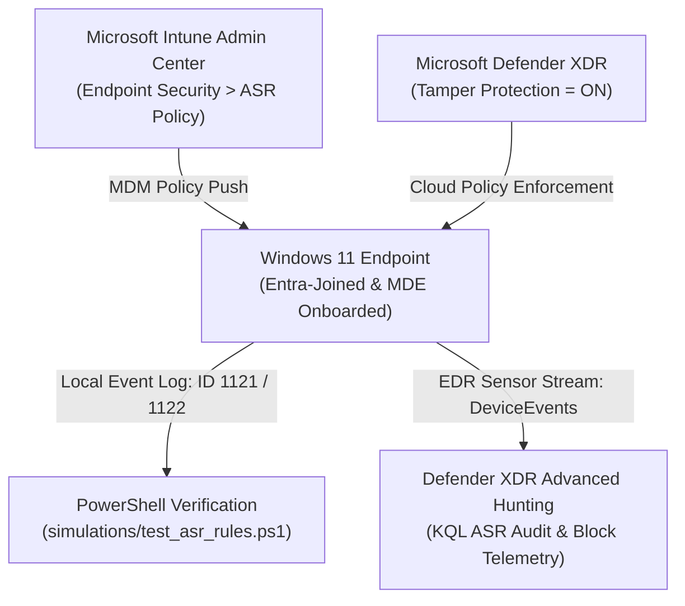

# Case Study 01: Endpoint Hardening, Attack Surface Reduction (ASR) & Tamper Protection

| Metadata | Details |
| :--- | :--- |
| **Role Focus** | Security Operations Analyst / Endpoint Security Engineer |
| **MITRE ATT&CK** | `T1003.001` (OS Credential Dumping: LSASS Memory), `T1027` (Obfuscated Files or Information), `T1047` (WMI), `T1562.001` (Impair Defenses: Disable or Modify Tools) |
| **Platforms Used** | Microsoft Intune, Microsoft Defender XDR (`security.microsoft.com`), Windows 11 Enterprise/Pro |
| **Automation / Query Assets** | [`simulations/test_asr_rules.ps1`](../simulations/test_asr_rules.ps1), [`queries/hunting_queries.kql`](../queries/hunting_queries.kql) |

---

## 🎯 1. Objective & Problem Statement

Adversaries routinely abuse built-in operating system features, Office macros, and credential dumping utilities (such as Mimikatz targeting `lsass.exe`) to escalate privileges and move laterally. Furthermore, once local administrator privileges are obtained, attackers attempt to disable Microsoft Defender Antivirus via registry modifications or PowerShell (`Set-MpPreference -DisableRealtimeMonitoring $true`).

**Engineering Objective:**
1. Onboard an Entra-joined Windows 11 endpoint into **Microsoft Defender for Endpoint (MDE)** and validate sensor health.
2. Author and deploy an enterprise **Attack Surface Reduction (ASR)** baseline policy via **Microsoft Intune**.
3. Enforce **Tamper Protection** at the tenant level to block unauthorized disabling of security controls.
4. Validate policy enforcement locally via PowerShell (`Get-MpPreference` & Windows Event IDs `1121`/`1122`) and centrally via KQL in **Defender XDR Advanced Hunting**.

---

## 🏗️ 2. Architecture & Telemetry Flow



---

## 🛠️ 3. Implementation & Engineering Procedure

### Phase 1: Endpoint Sensor & Onboarding Validation
1. Navigated to **Microsoft Defender XDR** (`https://security.microsoft.com`) > **Assets** > **Devices**.
2. Located the target Windows 11 workstation and verified the baseline telemetry indicators:
   - **Onboarding Status:** `Onboarded`
   - **Sensor Health State:** `Active`
   - **OS Platform:** `Windows 11`

📸 **Evidence — Device Onboarding & Sensor Health:**
> *Place screenshot at:* `../screenshots/case01_01_device_onboarded.png`  
> 

---

### Phase 2: Authoring the Intune Attack Surface Reduction (ASR) Baseline
In **Microsoft Intune** (`https://intune.microsoft.com` > **Endpoint security** > **Attack surface reduction**), I created the policy **`SecOps - Windows 11 ASR Baseline Policy`** enforcing the following high-impact rules:

| ASR Rule Name | Rule GUID | Configured Mode | MITRE ATT&CK Mitigated |
| :--- | :--- | :---: | :--- |
| Block credential stealing from Windows LSASS (`lsass.exe`) | `9e6c4e1f-7d60-472f-ba1a-a39ef669e4b2` | **Block** *(Audit during initial rollout)* | `T1003.001` |
| Block execution of potentially obfuscated scripts | `5beb8602-6816-4316-9774-a4b4847714e1` | **Block** | `T1027` / `T1059` |
| Block process creations originating from PSExec and WMI commands | `d1e49aac-8f56-4280-b9ba-993a6d77406c` | **Block** | `T1047` / `T1569.002` |
| Block all Office applications from creating child processes | `d4f940ab-401b-4efc-aadc-ad5f3c50688a` | **Block** | `T1204.002` |

📸 **Evidence — Intune ASR Policy Configuration:**
> *Place screenshot at:* `../screenshots/case01_02_intune_asr_policy.png`  
> 

---

### Phase 3: Enforcing Tenant-Wide Tamper Protection
1. In **Microsoft Defender XDR**, navigated to **Settings** > **Endpoints** > **Advanced features**.
2. Verified that **Tamper protection** is toggled **On**, ensuring local administrators cannot modify Defender registry keys or disable real-time protection via PowerShell.

📸 **Evidence — Tamper Protection Enabled:**
> *Place screenshot at:* `../screenshots/case01_03_tamper_protection.png`  
> 

---

### Phase 4: Local Endpoint Verification via PowerShell Automation
To programmatically audit whether Intune MDM policies converged on the endpoint, I authored and executed [`simulations/test_asr_rules.ps1`](../simulations/test_asr_rules.ps1).

The script performs three automated checks:
1. Queries `Get-MpPreference` and maps each configured `AttackSurfaceReductionRules_Ids` GUID to its human-readable rule name and enforcement state (`0=Disabled`, `1=Block`, `2=Audit`, `6=Warn`).
2. Queries `Get-MpComputerStatus` to verify `IsTamperProtected = True` and `RealTimeProtectionEnabled = True`.
3. Queries `Microsoft-Windows-Windows Defender/Operational` via XPath filter for **Event ID 1121** (ASR Block) and **Event ID 1122** (ASR Audit).

```powershell
# Run from an elevated PowerShell prompt on the Windows 11 endpoint
.\simulations\test_asr_rules.ps1
```

📸 **Evidence — Local PowerShell ASR & Tamper Audit Output:**
> *Place screenshot at:* `../screenshots/case01_04_powershell_asr_verification.png`  
> 

---

### Phase 5: Central Telemetry Verification in Defender XDR (KQL)
In **Defender XDR** > **Hunting** > **Advanced hunting**, I executed the following KQL query against the `DeviceEvents` table to correlate ASR block/audit events across the fleet and extract the specific `RuleId` from the JSON `AdditionalFields` column:

```kql
DeviceEvents
| where Timestamp > ago(7d)
| where ActionType startswith "Asr"
| parse AdditionalFields with * '"RuleId":"' AsrRuleId '"' *
| project Timestamp, DeviceName, ActionType, AsrRuleId, FileName, FolderPath, InitiatingProcessCommandLine
| sort by Timestamp desc
```

📸 **Evidence — KQL Advanced Hunting for ASR Events:**
> *Place screenshot at:* `../screenshots/case01_05_kql_asr_hunting.png`  
> 

---

## 📊 4. Key Findings & Operational Takeaways

- **Phased Rollout Prevents Business Disruption:** High-impact ASR rules (such as WMI/PSExec process creation blocks or LSASS memory protection) can occasionally flag legacy administrative tools or backup agents. Deploying rules in **Audit mode (`Action = 2`)** first and monitoring `ActionType endswith "Audited"` in `DeviceEvents` allows Detection Engineers to build safe exclusions before switching to **Block mode (`Action = 1`)**.
- **Defense-in-Depth with Tamper Protection:** ASR rules rely on the Microsoft Defender Antivirus engine (`MsMpEng.exe`) and real-time protection being active. Enforcing **Tamper Protection** guarantees that even if an attacker achieves local `SYSTEM` or Administrator privileges, they cannot disable the underlying sensor enforcing ASR.

