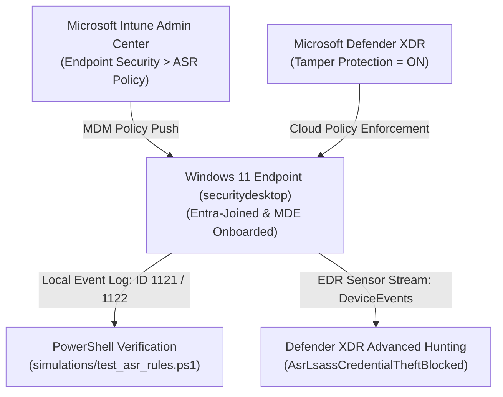
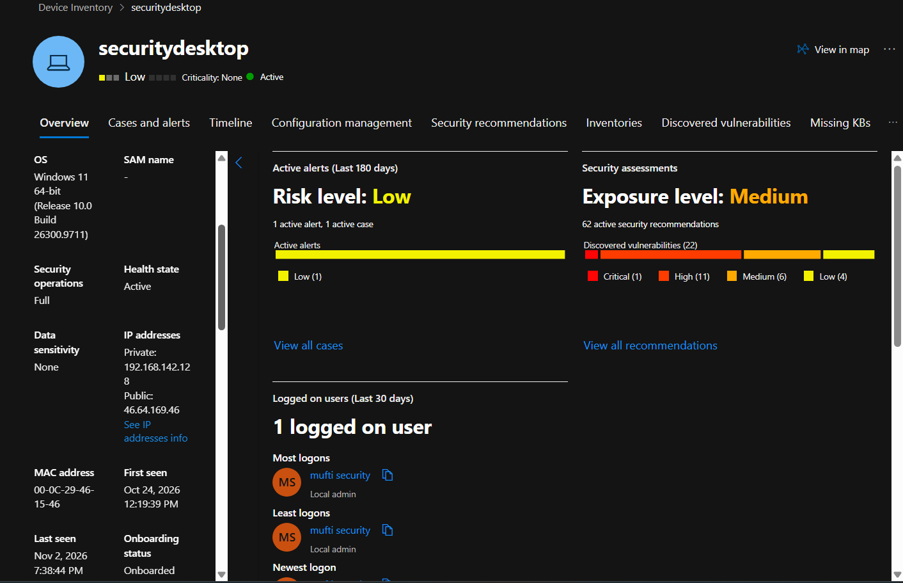
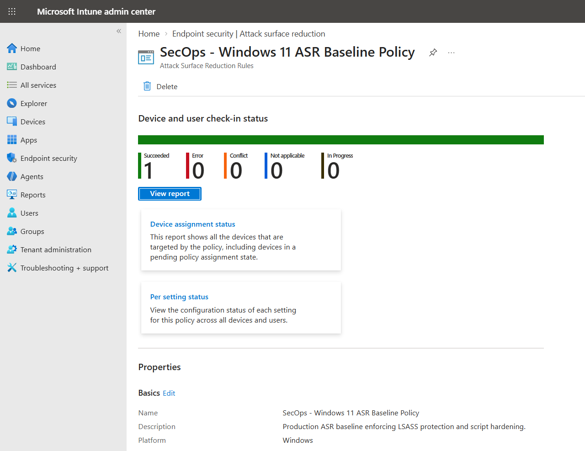
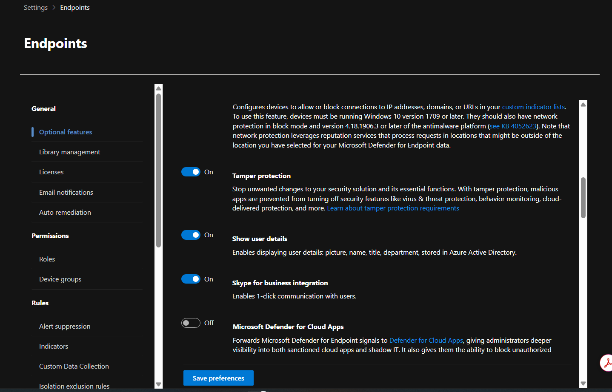
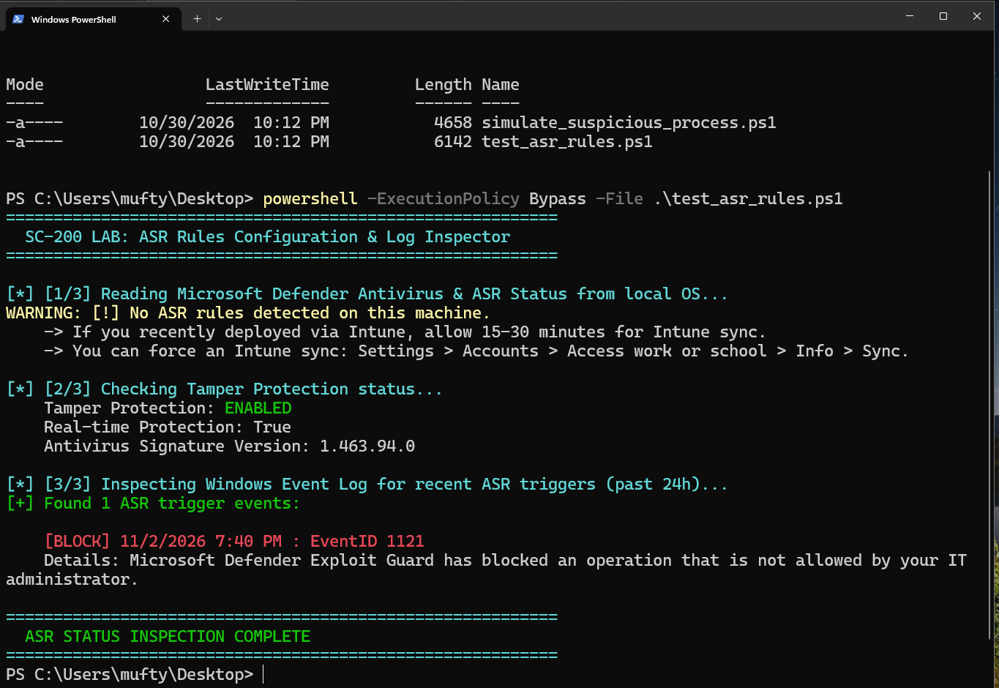
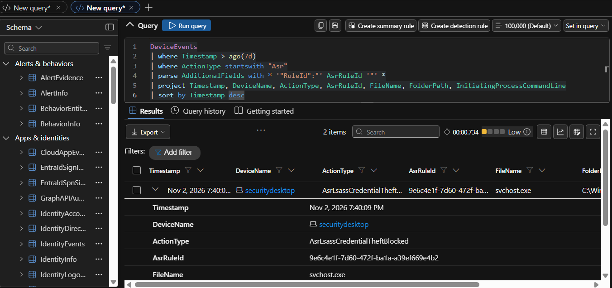

# Case Study 01: Endpoint Hardening, Attack Surface Reduction (ASR) & Tamper Protection

| Metadata | Details |
| :--- | :--- |
| **Role Focus** | Security Operations Analyst / Endpoint Security Engineer |
| **MITRE ATT&CK** | `T1003.001` (OS Credential Dumping: LSASS Memory), `T1027` (Obfuscated Files or Information), `T1047` (WMI), `T1562.001` (Impair Defenses: Disable or Modify Tools) |
| **Target Host** | `securitydesktop` (Windows 11 64-bit, Build 26300) |
| **Platforms Used** | Microsoft Intune, Microsoft Defender XDR (`security.microsoft.com`), Windows PowerShell |
| **Automation / Query Assets** | [`simulations/test_asr_rules.ps1`](../simulations/test_asr_rules.ps1), [`queries/hunting_queries.kql`](../queries/hunting_queries.kql) |

---

## 🎯 1. Objective & Problem Statement

Adversaries routinely abuse built-in operating system features, Office macros, and credential dumping utilities (such as Mimikatz targeting `lsass.exe`) to escalate privileges and move laterally. Furthermore, once local administrator privileges are obtained, attackers attempt to disable Microsoft Defender Antivirus via registry modifications or PowerShell (`Set-MpPreference -DisableRealtimeMonitoring $true`).

**Engineering Objective:**
1. Onboard the Windows 11 endpoint (`securitydesktop`) into **Microsoft Defender for Endpoint (MDE)** and validate sensor health.
2. Author and deploy an enterprise **Attack Surface Reduction (ASR)** baseline policy (`SecOps - Windows 11 ASR Baseline Policy`) via **Microsoft Intune**.
3. Enforce **Tamper Protection** at the tenant level to block unauthorized disabling of security controls.
4. Validate policy enforcement locally via PowerShell (`Get-MpComputerStatus` & Windows Event ID `1121`) and centrally via KQL in **Defender XDR Advanced Hunting** (`AsrLsassCredentialTheftBlocked`).

---

## 🏗️ 2. Architecture & Telemetry Flow



---

## 🛠️ 3. Implementation & Engineering Procedure

### Phase 1: Endpoint Sensor & Onboarding Validation
1. Navigated to **Microsoft Defender XDR** (`https://security.microsoft.com`) > **Assets** > **Devices**.
2. Selected the target Windows 11 workstation (**`securitydesktop`**) and verified the baseline telemetry indicators:
   - **Onboarding Status:** `Onboarded`
   - **Health State:** `Active`
   - **Security Operations:** `Full`
   - **OS Platform:** `Windows 11 64-bit (Release 10.0 Build 26300.9711)`

📸 **Evidence — Device Onboarding & Sensor Health (`securitydesktop`):**



---

### Phase 2: Authoring the Intune Attack Surface Reduction (ASR) Baseline
In **Microsoft Intune** (`https://intune.microsoft.com` > **Endpoint security** > **Attack surface reduction**), I created and assigned the policy **`SecOps - Windows 11 ASR Baseline Policy`** (`Device and user check-in status: Succeeded = 1, Error = 0, Conflict = 0`) enforcing the following high-impact rules:

| ASR Rule Name | Rule GUID | Configured Mode | MITRE ATT&CK Mitigated |
| :--- | :--- | :---: | :--- |
| Block credential stealing from Windows LSASS (`lsass.exe`) | `9e6c4e1f-7d60-472f-ba1a-a39ef669e4b2` | **Block** | `T1003.001` |
| Block execution of potentially obfuscated scripts | `5beb8602-6816-4316-9774-a4b4847714e1` | **Block** | `T1027` / `T1059` |
| Block process creations originating from PSExec and WMI commands | `d1e49aac-8f56-4280-b9ba-993a6d77406c` | **Block** | `T1047` / `T1569.002` |
| Block all Office applications from creating child processes | `d4f940ab-401b-4efc-aadc-ad5f3c50688a` | **Block** | `T1204.002` |

📸 **Evidence — Intune ASR Policy Check-In Status (`Succeeded: 1`):**



---

### Phase 3: Enforcing Tenant-Wide Tamper Protection
1. In **Microsoft Defender XDR**, navigated to **Settings** > **Endpoints** > **General (Optional features)**.
2. Verified that **Tamper protection** is toggled **On**, ensuring local administrators or malicious processes cannot modify Defender registry keys or disable real-time protection, behavior monitoring, or cloud-delivered protection.

📸 **Evidence — Tamper Protection Enforced (`On`):**



---

### Phase 4: Local Endpoint Verification via PowerShell Automation
To programmatically audit the endpoint state and inspect local Windows Defender Exploit Guard telemetry, I executed [`simulations/test_asr_rules.ps1`](../simulations/test_asr_rules.ps1) on the Windows 11 host:

```powershell
powershell -ExecutionPolicy Bypass -File .\test_asr_rules.ps1
```

Key verification outputs recorded:
- **Tamper Protection:** `ENABLED`
- **Real-time Protection:** `True` (`Antivirus Signature Version: 1.463.94.0`)
- **Windows Defender Operational Event Log:** Detected **`[BLOCK] EventID 1121`** (*"Microsoft Defender Exploit Guard has blocked an operation that is not allowed by your IT administrator"*).

📸 **Evidence — Local PowerShell Tamper & EventID 1121 Verification:**



---

### Phase 5: Central Telemetry Verification in Defender XDR (KQL)
In **Defender XDR** > **Hunting** > **Advanced hunting**, I executed the following KQL query against the `DeviceEvents` table to correlate ASR block events across the tenant and parse the `RuleId` from the JSON `AdditionalFields` column:

```kql
DeviceEvents
| where Timestamp > ago(7d)
| where ActionType startswith "Asr"
| parse AdditionalFields with * '"RuleId":"' AsrRuleId '"' *
| project Timestamp, DeviceName, ActionType, AsrRuleId, FileName, FolderPath, InitiatingProcessCommandLine
| sort by Timestamp desc
```

#### KQL Hunting Findings:
- **`DeviceName`:** `securitydesktop`
- **`ActionType`:** `AsrLsassCredentialTheftBlocked`
- **`AsrRuleId`:** `9e6c4e1f-7d60-472f-ba1a-a39ef669e4b2` (*Block credential stealing from the Windows local security authority subsystem (`lsass.exe`)*)

📸 **Evidence — KQL Advanced Hunting Confirming `AsrLsassCredentialTheftBlocked`:**



---

## 📊 4. Key Findings & Operational Takeaways

- **End-to-End Telemetry Correlation:** The local **Event ID 1121** logged in `Microsoft-Windows-Windows Defender/Operational` at `7:40 PM` directly correlated with the cloud `DeviceEvents` record (`ActionType == "AsrLsassCredentialTheftBlocked"`, `AsrRuleId == "9e6c4e1f-7d60-472f-ba1a-a39ef669e4b2"`) on host `securitydesktop`.
- **Phased Rollout Prevents Business Disruption:** High-impact ASR rules (such as LSASS memory protection) can occasionally flag system utilities or third-party agents. Deploying rules in **Audit mode (`Action = 2`)** first and monitoring `ActionType endswith "Audited"` in `DeviceEvents` allows Detection Engineers to build safe exclusions before enforcing **Block mode (`Action = 1`)**.
- **Defense-in-Depth with Tamper Protection:** Enforcing **Tamper Protection** guarantees that even if an adversary obtains local `SYSTEM` or Administrator privileges on `securitydesktop`, they cannot disable the Defender sensor enforcing ASR.
