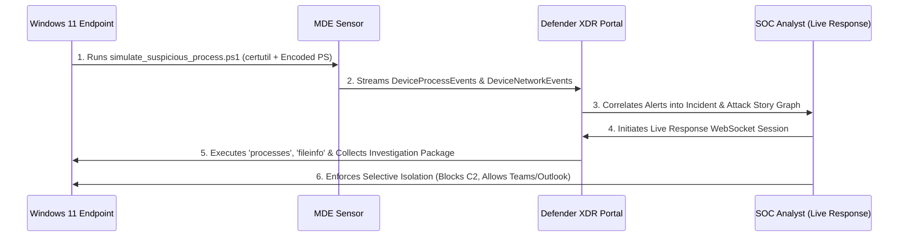

# Case Study 02: Incident Triage, Attack Story Correlation & Live Response Containment

| Metadata | Details |
| :--- | :--- |
| **Role Focus** | Tier 1 / Tier 2 SOC Analyst & Incident Responder |
| **MITRE ATT&CK** | `T1105` (Ingress Tool Transfer — `certutil.exe`), `T1059.001` (Command and Scripting Interpreter: PowerShell `-EncodedCommand`) |
| **Platforms Used** | Microsoft Defender XDR (`security.microsoft.com`), Defender for Endpoint Live Response, Windows 11 |
| **Automation / Query Assets** | [`simulations/simulate_suspicious_process.ps1`](../simulations/simulate_suspicious_process.ps1), [`queries/hunting_queries.kql`](../queries/hunting_queries.kql) |

---

## 🎯 1. Objective & Problem Statement

Modern attackers frequently evade signature-based antivirus by abusing native, Microsoft-signed binaries (**Living-off-the-Land Binaries and Scripts — LOLBAS**) such as `certutil.exe` to stage payloads from external URLs, followed by Base64-encoded PowerShell execution (`-EncodedCommand`) to hide malicious logic in memory.

**Engineering & Incident Response Objective:**
1. Execute a safe, auto-cleaning purple-team script ([`simulate_suspicious_process.ps1`](../simulations/simulate_suspicious_process.ps1)) on an onboarded Windows 11 workstation to generate authentic `T1105` and `T1059.001` telemetry.
2. Triage the resulting incident in **Microsoft Defender XDR**, analyzing the **Attack Story** process tree and **Device Timeline**.
3. Initiate an encrypted **Live Response** remote shell session to collect volatile forensic artifacts (`processes`, `fileinfo`, and an **Investigation Package**).
4. Evaluate **Selective Isolation** vs. **Full Network Isolation** to contain active threats while preserving communication channels with the user.

---

## 🏗️ 2. Incident Triage & Containment Workflow



---

## 🛠️ 3. Investigation & Response Walkthrough

### Phase 1: Adversary Emulation (Generating LOLBAS & Encoded PowerShell Telemetry)
On the Windows 11 endpoint, I executed [`simulations/simulate_suspicious_process.ps1`](../simulations/simulate_suspicious_process.ps1), which performs two controlled behaviors before automatically cleaning up all artifacts:
- **Stage 1 (`T1105`):** Invokes `certutil.exe -urlcache -split -f` to download a harmless documentation file from GitHub into `$env:TEMP\SC200_Lab`, followed by flushing the URL cache.
- **Stage 2 (`T1059.001`):** Converts a benign status output string into Unicode Base64 and executes `powershell.exe -NoProfile -NonInteractive -EncodedCommand <Base64>`.

```powershell
# Executed on the target Windows 11 workstation
.\simulations\simulate_suspicious_process.ps1
```

📸 **Evidence — Purple-Team Script Execution:**
> *Place screenshot at:* `../screenshots/case02_01_simulation_execution.png`  
> 

---

### Phase 2: Incident Triage, Attack Story & Process Tree Analysis
1. In **Microsoft Defender XDR** (`https://security.microsoft.com`), navigated to **Incidents & alerts** > **Incidents**.
2. Opened the correlated incident and inspected the **Attack Story** graph:
   - Verified the parent-child execution hierarchy:
     ```text
     powershell.exe (Initiating Parent Process)
      ├── certutil.exe -urlcache -split -f "https://raw.githubusercontent.com/..."
      └── powershell.exe -NoProfile -NonInteractive -EncodedCommand ...
     ```
3. Inspected the **Device Timeline** to correlate the exact microsecond sequence of `ProcessCreated` and outbound `ConnectionSuccess` events.

📸 **Evidence — Defender XDR Attack Story & Process Tree:**
> *Place screenshot at:* `../screenshots/case02_02_attack_story_graph.png`  
> 

---

### Phase 3: Remote Forensic Triage via Defender Live Response
To inspect volatile state on the endpoint without tipping off an attacker via RDP logons:
1. Verified that **Live Response** is enabled under **Settings** > **Endpoints** > **Advanced features**.
2. Navigated to **Assets** > **Devices**, selected the Windows 11 host, and clicked **Initiate Live Response Session**.
3. Executed native forensic verification commands inside the secure cloud shell:
   ```shell
   # Enumerate active processes and PIDs
   processes

   # Inspect directory contents
   dir "C:\Users"

   # Retrieve cryptographic hashes (SHA-256), PE metadata, and timestamps for certutil.exe
   fileinfo "C:\Windows\System32\certutil.exe"
   ```
4. Triggered **Collect investigation package** from the device action bar to capture an archive of active autoruns, prefetch files, event logs, and network sockets into the **Action Center**.

📸 **Evidence — Live Response CLI Session (`processes` & `fileinfo`):**
> *Place screenshot at:* `../screenshots/case02_03_live_response_cli.png`  
> 

---

### Phase 4: Host Containment — Selective vs. Full Isolation
From the device response toolbar, I evaluated **Isolate device** options:
- **Full Isolation:** Drops all inbound and outbound network traffic at the kernel filter driver level except heartbeats to the Defender cloud service.
- **Selective Isolation (Selected for User Workstation Triage):** Restricts all network traffic while permitting **Outlook, Microsoft Teams, and Skype** traffic. This prevents command-and-control (C2) exfiltration and lateral movement while allowing the SOC analyst to contact the employee over Teams to verify activity.

📸 **Evidence — Device Isolation & Action Center History:**
> *Place screenshot at:* `../screenshots/case02_04_selective_isolation.png`  
> 

---

### Phase 5: Advanced Hunting Verification (KQL)
To verify the complete command-line arguments logged by the EDR sensor, I ran the following KQL query in **Hunting** > **Advanced hunting**:

```kql
DeviceProcessEvents
| where Timestamp > ago(2h)
| where FileName =~ "certutil.exe"
| where ProcessCommandLine has_any ("-urlcache", "-split")
| project Timestamp, DeviceName, AccountName, ProcessCommandLine, InitiatingProcessFileName
| sort by Timestamp desc
```

📸 **Evidence — KQL Verification of `certutil.exe` Telemetry:**
> *Place screenshot at:* `../screenshots/case02_05_kql_certutil_telemetry.png`  
> 

---

## 📊 4. Key Findings & Operational Takeaways

- **Why Live Response Beats RDP During Active IR:** Connecting to a compromised host via RDP (`LogonType 10`) caches credentials in LSASS on the target machine—exposing the responder's credentials to theft if an attacker has active memory-dumping tooling on the box. **Defender Live Response** operates over an encrypted sensor WebSocket channel without creating an interactive Windows logon session.
- **Selective Isolation Reduces Business Friction:** On remote corporate laptops, full network isolation immediately cuts off the user, often prompting them to reboot or call the helpdesk. **Selective Isolation** contains network-borne lateral movement while keeping Teams open for coordinated remediation.

