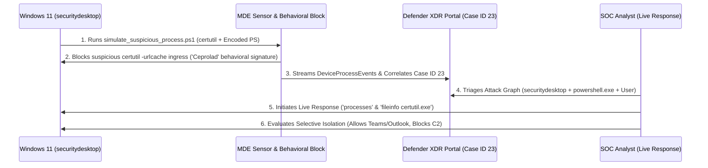
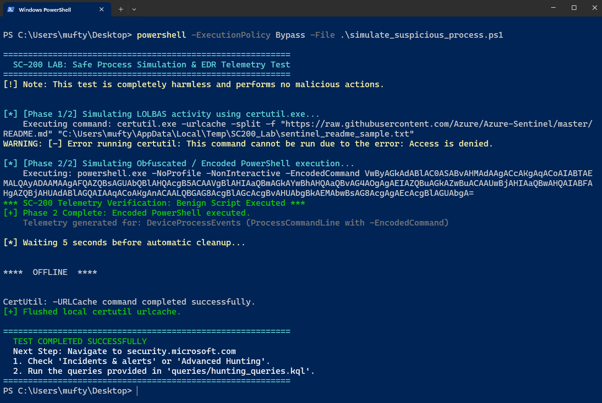
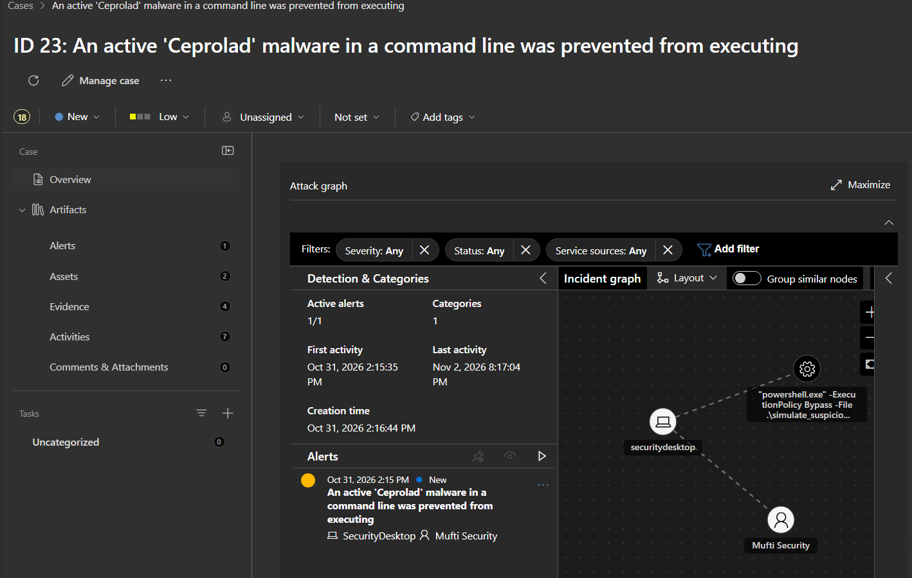
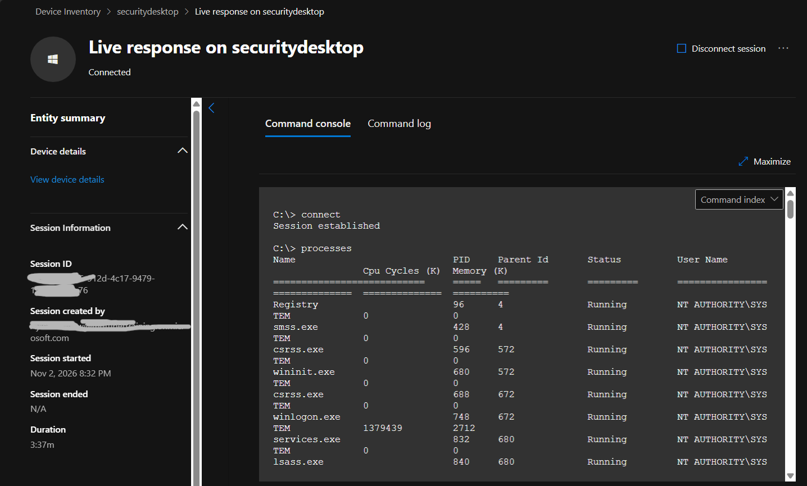
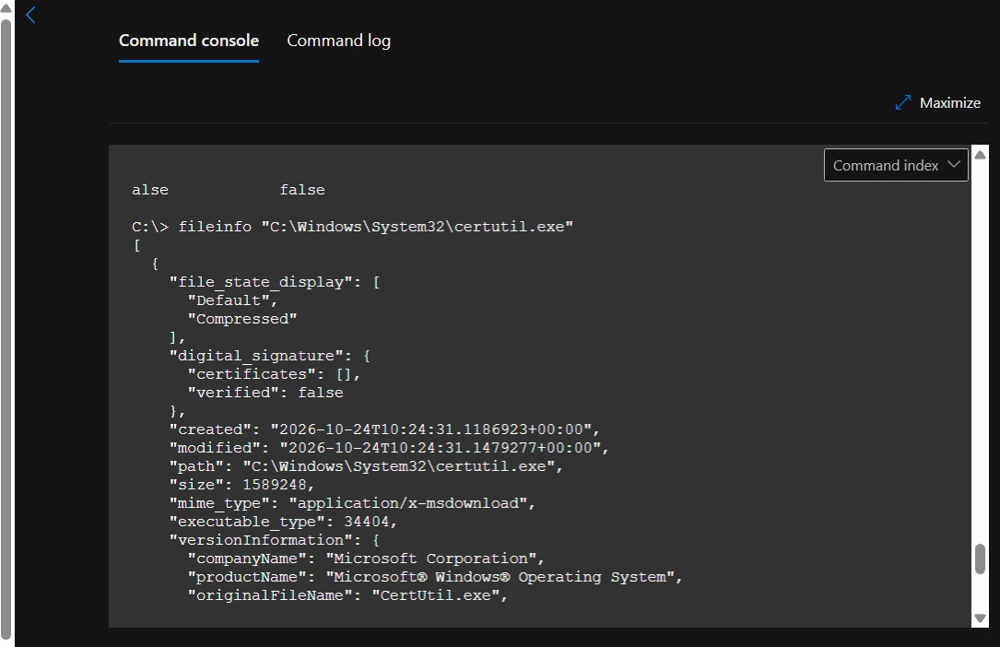
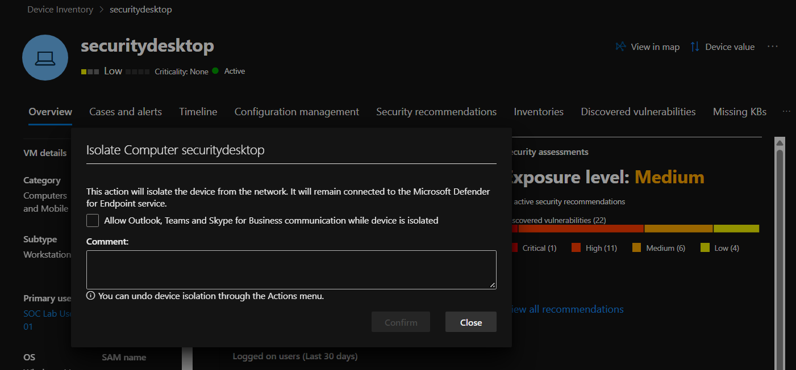
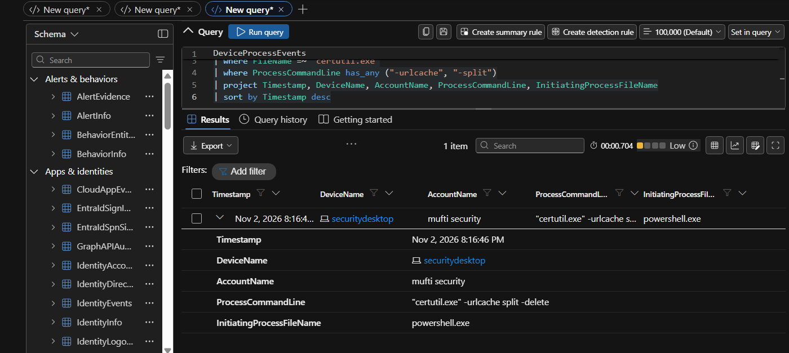

# Case Study 02: Incident Triage, Attack Story Correlation & Live Response Containment

| Metadata | Details |
| :--- | :--- |
| **Role Focus** | Tier 1 / Tier 2 SOC Analyst & Incident Responder |
| **MITRE ATT&CK** | `T1105` (Ingress Tool Transfer — `certutil.exe`), `T1059.001` (Command and Scripting Interpreter: PowerShell `-EncodedCommand`) |
| **Target Host** | `securitydesktop` (Windows 11 64-bit) |
| **Correlated Case** | **Case ID 23:** *An active 'Ceprolad' malware in a command line was prevented from executing* |
| **Platforms Used** | Microsoft Defender XDR (`security.microsoft.com`), Defender for Endpoint Live Response, Windows PowerShell |
| **Automation / Query Assets** | [`simulations/simulate_suspicious_process.ps1`](../simulations/simulate_suspicious_process.ps1), [`queries/hunting_queries.kql`](../queries/hunting_queries.kql) |

---

## 🎯 1. Objective & Problem Statement

Modern attackers frequently attempt to evade traditional antivirus by abusing native, Microsoft-signed binaries (**Living-off-the-Land Binaries and Scripts — LOLBAS**) such as `certutil.exe` to stage payloads from external URLs, followed by Base64-encoded PowerShell execution (`-EncodedCommand`) to hide malicious logic in memory.

**Engineering & Incident Response Objective:**
1. Execute a safe, auto-cleaning purple-team script ([`simulate_suspicious_process.ps1`](../simulations/simulate_suspicious_process.ps1)) on the onboarded Windows 11 workstation (`securitydesktop`) to generate authentic `T1105` and `T1059.001` telemetry.
2. Triage the resulting incident (**Case ID 23**) in **Microsoft Defender XDR**, analyzing the **Attack Graph** process/entity correlation.
3. Initiate an encrypted **Live Response** remote shell session to `securitydesktop` to inspect active system processes (`processes`) and binary metadata (`fileinfo "C:\Windows\System32\certutil.exe"`).
4. Evaluate **Selective Isolation** vs. **Full Network Isolation** to contain active threats while preserving communication channels with the user.

---

## 🏗️ 2. Incident Triage & Containment Workflow



---

## 🛠️ 3. Investigation & Response Walkthrough

### Phase 1: Adversary Emulation (Generating LOLBAS & Encoded PowerShell Telemetry)
On the Windows 11 endpoint (`securitydesktop`), I executed [`simulations/simulate_suspicious_process.ps1`](../simulations/simulate_suspicious_process.ps1):

```powershell
powershell -ExecutionPolicy Bypass -File .\simulate_suspicious_process.ps1
```

#### Observed Endpoint Behavior:
- **Stage 1 (`T1105` — LOLBAS Ingress Attempt):** Invoked `certutil.exe -urlcache -split -f "https://raw.githubusercontent.com/Azure/Azure-Sentinel/master/README.md"`. Microsoft Defender behavioral monitoring immediately intercepted the command-line pattern (`Access is denied`) and raised a behavioral prevention alert (`'Ceprolad' malware in a command line was prevented from executing`).
- **Stage 2 (`T1059.001` — Base64 Encoded PowerShell):** Executed `powershell.exe -NoProfile -NonInteractive -EncodedCommand VwByAGkAdABlAC0ASABvAHMAdAAg...`, generating `DeviceProcessEvents` telemetry for obfuscated command execution.
- **Stage 3 (Cache Cleanup):** Executed `certutil.exe -urlcache split -delete` to flush the local URL cache.

📸 **Evidence — Purple-Team Script Execution & Real-Time Behavioral Interception:**



---

### Phase 2: Incident Triage & Attack Graph Analysis
1. In **Microsoft Defender XDR** (`https://security.microsoft.com`), navigated to **Incidents & alerts**.
2. Opened **Case ID 23** (*"An active 'Ceprolad' malware in a command line was prevented from executing"*) and inspected the **Incident Graph**:
   - Correlated **1 Active Alert**, **2 Assets** (`securitydesktop` and user `Mufti Security`), and **4 Evidence items**.
   - Verified the process node `"powershell.exe" -ExecutionPolicy Bypass -File .\simulate_suspicious_process.ps1` linked directly to `securitydesktop`.

📸 **Evidence — Defender XDR Case ID 23 & Attack Graph Correlation:**



---

### Phase 3: Remote Forensic Triage via Defender Live Response
To inspect volatile state on `securitydesktop` without establishing an interactive RDP logon session:
1. Navigated to **Device Inventory** > **`securitydesktop`** and initiated a **Live Response** session.
2. Executed `processes` inside the encrypted cloud command console to enumerate active kernel and system processes (`Registry` PID 96, `smss.exe` PID 428, `csrss.exe` PID 596, `wininit.exe` PID 680, `winlogon.exe` PID 748, `services.exe` PID 832, and `lsass.exe` PID 840 running under `NT AUTHORITY\SYSTEM`):

```shell
C:\> connect
Session established

C:\> processes
```

📸 **Evidence — Live Response Console (`processes` Enumeration on `securitydesktop`):**



3. Executed `fileinfo` against `C:\Windows\System32\certutil.exe` to verify binary integrity, PE version metadata, and timestamps (`size: 1589248`, `executable_type: 34404`, `companyName: Microsoft Corporation`, `originalFileName: CertUtil.exe`):

```shell
C:\> fileinfo "C:\Windows\System32\certutil.exe"
```

📸 **Evidence — Live Response Forensic Binary Inspection (`fileinfo certutil.exe`):**



---

### Phase 4: Host Containment — Selective vs. Full Network Isolation
From the `securitydesktop` device response menu, I opened the **Isolate Computer `securitydesktop`** workflow to evaluate containment options:
- **Full Isolation:** Severely restricts all inbound and outbound network communication at the Defender filter driver level, permitting only telemetry heartbeats to the Microsoft Defender for Endpoint cloud service.
- **Selective Isolation (`Allow Outlook, Teams and Skype for Business communication while device is isolated`):** Blocks external C2 and lateral movement while keeping corporate communication channels active so the SOC analyst can coordinate directly with the user (`SOC Lab User 01`).

📸 **Evidence — Selective Network Isolation Configuration (`securitydesktop`):**



---

### Phase 5: Advanced Hunting Verification (KQL)
To verify the raw process execution telemetry recorded in `DeviceProcessEvents`, I ran the following KQL query in **Hunting** > **Advanced hunting**:

```kql
DeviceProcessEvents
| where FileName =~ "certutil.exe"
| where ProcessCommandLine has_any ("-urlcache", "-split")
| project Timestamp, DeviceName, AccountName, ProcessCommandLine, InitiatingProcessFileName
| sort by Timestamp desc
```

#### KQL Hunting Findings:
- **`Timestamp`:** `Nov 2, 2026 8:16:46 PM`
- **`DeviceName`:** `securitydesktop`
- **`AccountName`:** `mufti security`
- **`ProcessCommandLine`:** `"certutil.exe" -urlcache split -delete`
- **`InitiatingProcessFileName`:** `powershell.exe`

📸 **Evidence — KQL Verification of `certutil.exe` Execution Telemetry:**



---

## 📊 4. Key Findings & Operational Takeaways

- **Behavioral Command-Line Prevention (`Ceprolad` Signature):** Even though `certutil.exe` is a legitimate Microsoft-signed binary (`C:\Windows\System32\certutil.exe`), Defender's AMSI and command-line behavioral monitoring immediately recognized the `-urlcache -split -f <http>` ingress flag combination and blocked execution before payload write—demonstrating why behavioral EDR outperforms static hash blocklists.
- **Why Live Response Beats RDP During Active IR:** Connecting to a compromised host via RDP (`LogonType 10`) caches responder credentials in `lsass.exe` (PID 840) on the target machine. **Defender Live Response** operates over an encrypted sensor WebSocket channel without creating an interactive Windows logon session.
- **Selective Isolation Reduces Business Friction:** Enabling *"Allow Outlook, Teams and Skype for Business communication while device is isolated"* contains network-borne lateral movement while keeping Teams open for coordinated remediation.
