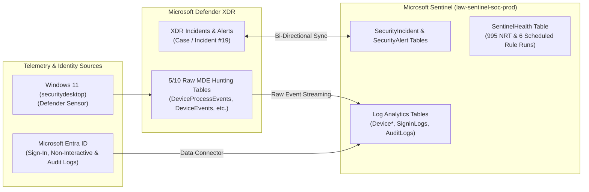
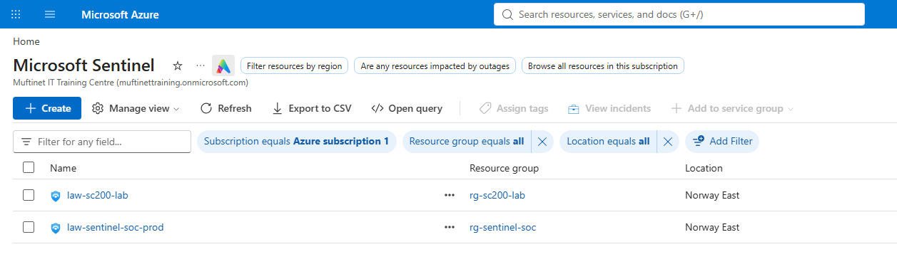
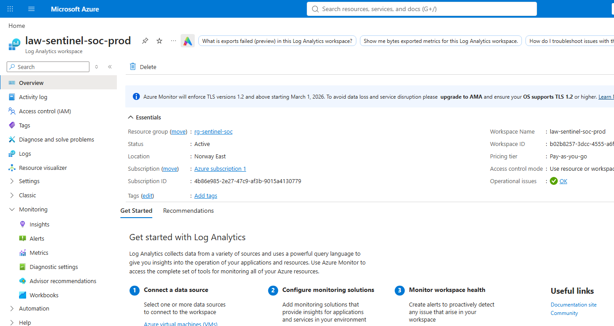
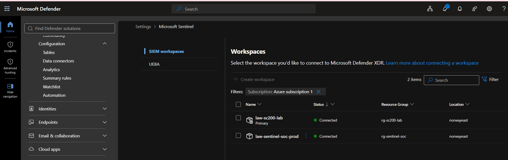
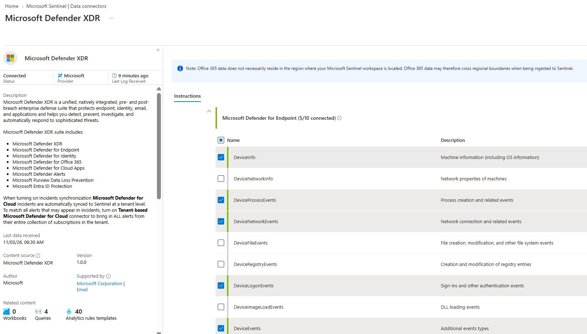
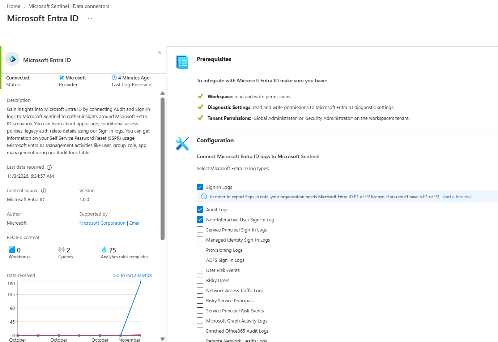
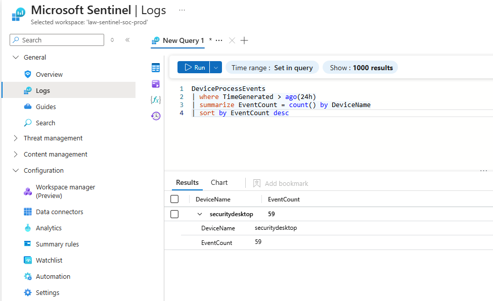
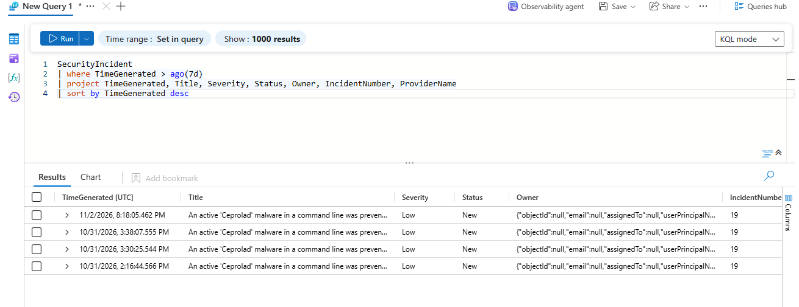
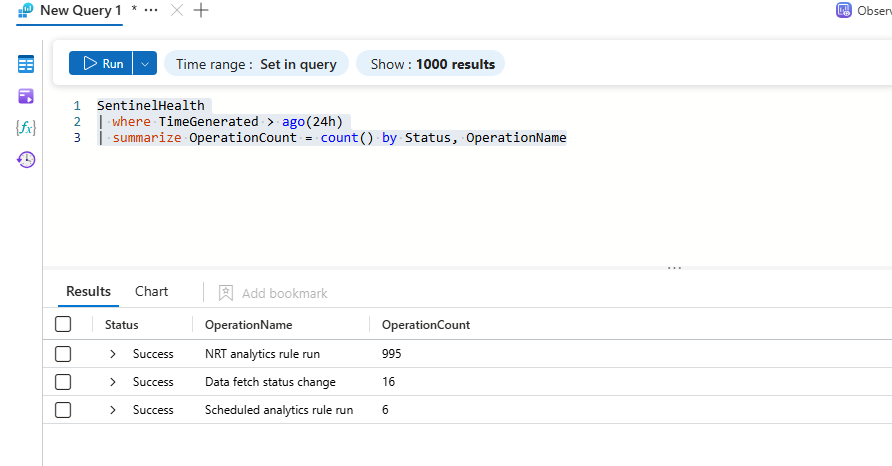

# Case Study 03: Enterprise SIEM Deployment & Bi-Directional Defender XDR Synchronization

| Metadata | Details |
| :--- | :--- |
| **Role Focus** | SIEM Engineer / SOC Architecture |
| **Core Capabilities** | Log Analytics Workspace Design, Unified SecOps Portal Onboarding, Bi-Directional Incident Sync, Raw EDR Table Streaming, `SentinelHealth` Monitoring |
| **SIEM Workspaces** | `law-sentinel-soc-prod` (`rg-sentinel-soc`) & `law-sc200-lab` (`rg-sc200-lab`) — `Norway East` |
| **Platforms Used** | Microsoft Sentinel, Azure Log Analytics, Microsoft Defender XDR Unified Portal, Microsoft Entra ID |
| **Automation / Query Assets** | [`queries/hunting_queries.kql`](../queries/hunting_queries.kql) |

---

## 🎯 1. Objective & Problem Statement

In a hybrid or multi-cloud enterprise, Security Operations Centers cannot rely on disconnected portals. If Tier 1 analysts work inside **Microsoft Sentinel (SIEM)** while endpoint detections originate in **Microsoft Defender XDR**, lack of synchronization leads to duplicate ticket handling, split investigation timelines, and blind spots when log connectors silently fail.

**Engineering Objective:**
1. Provision an enterprise **Log Analytics Workspace** (`law-sentinel-soc-prod` in `Norway East`), onboard **Microsoft Sentinel**, and integrate the workspace into the **Unified Microsoft Defender XDR Portal**.
2. Configure the **Microsoft Defender XDR Data Connector** with **Bi-Directional Incident Synchronization** so incident status, severity, and owner assignments mirror automatically between Sentinel and Defender XDR.
3. Selectively ingest the **5 core raw endpoint telemetry tables** (`DeviceProcessEvents`, `DeviceNetworkEvents`, `DeviceEvents`, `DeviceLogonEvents`, `DeviceInfo`) and **Microsoft Entra ID** identity logs (`SigninLogs`, `AuditLogs`, `AADNonInteractiveUserSignInLogs`).
4. Enable **Workspace Health Monitoring** (`SentinelHealth`) and verify end-to-end ingestion and rule execution health via KQL.

---

## 🏗️ 2. SIEM & XDR Integration Architecture



---

## 🛠️ 3. Implementation & Engineering Procedure

### Phase 1: Log Analytics Workspace, Sentinel Onboarding & Unified Portal Integration
1. In the **Azure Portal** (`https://portal.azure.com`), provisioned resource group `rg-sentinel-soc` and Log Analytics Workspace **`law-sentinel-soc-prod`** in region **`Norway East`** (`Pricing tier: Pay-as-you-go`, `Status: Active`, `Operational issues: OK`).
2. Onboarded **Microsoft Sentinel** onto the workspace and connected the SIEM workspaces (`law-sc200-lab` and `law-sentinel-soc-prod`) into the **Unified Microsoft Defender Portal** (**Settings > Microsoft Sentinel > SIEM workspaces**).

📸 **Evidence — Microsoft Sentinel Workspaces Deployed (`Norway East`):**



📸 **Evidence — Log Analytics Workspace `law-sentinel-soc-prod` Configuration & Health:**



📸 **Evidence — Unified Defender XDR Portal SIEM Workspace Connection (`Connected`):**



---

### Phase 2: Configuring Bi-Directional Defender XDR Sync & Raw Table Streaming
In **Microsoft Sentinel** > **Configuration** > **Data connectors**, I configured the **Microsoft Defender XDR** connector (`Status: Connected`) across two layers:

1. **Incidents & Alerts Synchronization:**
   - Enabled **Connect incidents & alerts**, streaming correlated XDR incidents into `SecurityIncident` and `SecurityAlert` with two-way state synchronization.
2. **Raw Advanced Hunting Event Streaming (`5/10 connected`):**
   - Selectively enabled streaming for the 5 highest-signal **Microsoft Defender for Endpoint** tables required for custom analytics rules and cross-source hunting while optimizing ingestion volume:
     - ☑️ `DeviceInfo` (*Machine information, including OS information*)
     - ☑️ `DeviceProcessEvents` (*Process creation and related events*)
     - ☑️ `DeviceNetworkEvents` (*Network connection and related events*)
     - ☑️ `DeviceLogonEvents` (*Sign-ins and other authentication events*)
     - ☑️ `DeviceEvents` (*ASR triggers, AV detections, and control events*)

📸 **Evidence — Microsoft Defender XDR Connector (`5/10` MDE Raw Tables Connected):**



---

### Phase 3: Onboarding Microsoft Entra ID Identity Telemetry
Connected the **Microsoft Entra ID** data connector (`Status: Connected`, `Prerequisites: Workspace, Diagnostic Settings & Tenant Permissions Verified`) to stream identity telemetry for correlation with endpoint events:
- ☑️ **Sign-In Logs** (`SigninLogs` — interactive user sign-ins, MFA challenges, Conditional Access results)
- ☑️ **Audit Logs** (`AuditLogs` — role assignments, app registrations, group changes)
- ☑️ **Non-Interactive User Sign-In Log** (`AADNonInteractiveUserSignInLogs` — service client & background token refresh sign-ins)

📸 **Evidence — Microsoft Entra ID Data Connector Active & Streaming:**



---

### Phase 4: Enabling `SentinelHealth` Operational Monitoring
In **Microsoft Sentinel** > **Settings** > **Workspace health monitoring**, I enabled both **Data collection health monitoring** and **Analytics rules health monitoring** to populate the `SentinelHealth` table with diagnostic telemetry for connector state transitions and scheduled/NRT rule executions.

---

### Phase 5: KQL Ingestion & Health Validation
Executed three verification queries in **Microsoft Sentinel > Logs** (`law-sentinel-soc-prod`):

#### Check 1: Verify Endpoint Process Telemetry Volume by Host (`DeviceProcessEvents`)
```kql
DeviceProcessEvents
| where TimeGenerated > ago(24h)
| summarize EventCount = count() by DeviceName
| sort by EventCount desc
```
- **Result:** Confirmed active raw EDR telemetry streaming from **`securitydesktop`** (`EventCount = 59`).

📸 **Evidence — KQL Verification of `DeviceProcessEvents` Streaming (`securitydesktop = 59`):**



---

#### Check 2: Verify Bi-Directional Incident Ingestion from Defender XDR (`SecurityIncident`)
```kql
SecurityIncident
| where TimeGenerated > ago(7d)
| project TimeGenerated, Title, Severity, Status, Owner, IncidentNumber, ProviderName
| sort by TimeGenerated desc
```
- **Result:** Confirmed that the Defender XDR endpoint incident (**`An active 'Ceprolad' malware in a command line was prevented from executing`**, `IncidentNumber = 19`) automatically synchronized into Microsoft Sentinel's `SecurityIncident` table.

📸 **Evidence — KQL Verification of Synchronized Incidents in `SecurityIncident`:**



---

#### Check 3: Audit SIEM Connector & Analytics Engine Operational Health (`SentinelHealth`)
```kql
SentinelHealth
| where TimeGenerated > ago(24h)
| summarize OperationCount = count() by Status, OperationName
```
- **Result:** Verified `100% Success` status across all SIEM operations over the 24-hour window:
  - `NRT analytics rule run`: **`995` successful executions**
  - `Data fetch status change`: **`16` successful connector polls**
  - `Scheduled analytics rule run`: **`6` successful executions**

📸 **Evidence — KQL Verification of `SentinelHealth` (`995` NRT & `6` Scheduled Rule Runs):**



---

## 📊 4. Key Findings & Operational Takeaways

- **Eliminating Duplicate Triage via Bi-Directional Sync:** Connecting Defender XDR via the native incident connector automatically synchronized the `'Ceprolad'` endpoint incident (`IncidentNumber 19`) into Sentinel's `SecurityIncident` table, ensuring status updates mirror across both portals.
- **Cost vs. Visibility Optimization (`5/10` MDE Tables):** Streaming all 10+ raw MDE tables (such as noisy `DeviceImageLoadEvents` DLL loads on every workstation) can rapidly inflate Log Analytics ingestion costs. Selecting the 5 core tables (`DeviceInfo`, `DeviceProcessEvents`, `DeviceNetworkEvents`, `DeviceLogonEvents`, `DeviceEvents`) provides full process, logon, network, and ASR visibility while maintaining predictable SIEM ingestion spend.
- **Continuous SIEM Observability via `SentinelHealth`:** Auditing `SentinelHealth` confirmed `995` consecutive successful Near-Real-Time (NRT) rule executions and `16` healthy data connector fetches without silent failures.
