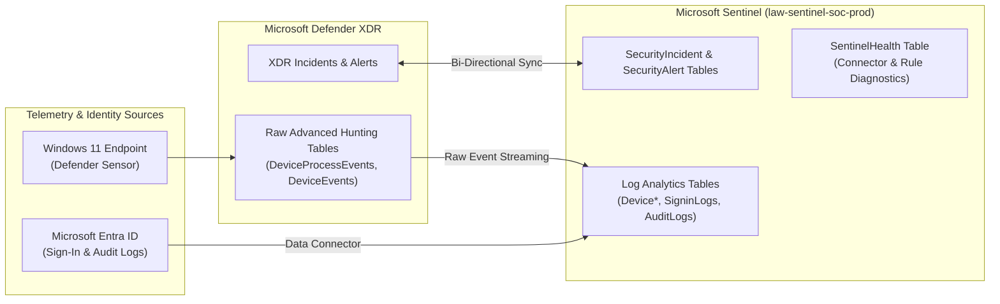

# Case Study 03: Enterprise SIEM Deployment & Bi-Directional Defender XDR Synchronization

| Metadata | Details |
| :--- | :--- |
| **Role Focus** | SIEM Engineer / SOC Architecture |
| **Core Capabilities** | Log Analytics Workspace Design, Bi-Directional Incident Sync, Raw EDR Table Streaming, `SentinelHealth` Monitoring |
| **Platforms Used** | Microsoft Sentinel, Azure Log Analytics (`law-sentinel-soc-prod`), Microsoft Defender XDR, Microsoft Entra ID |
| **Automation / Query Assets** | [`queries/hunting_queries.kql`](../queries/hunting_queries.kql) |

---

## 🎯 1. Objective & Problem Statement

In a hybrid or multi-cloud enterprise, Security Operations Centers cannot rely on disconnected portals. If Tier 1 analysts work inside **Microsoft Sentinel (SIEM)** while endpoint detections originate in **Microsoft Defender XDR**, lack of synchronization leads to duplicate ticket handling, split investigation timelines, and blind spots when log connectors silently fail.

**Engineering Objective:**
1. Provision an enterprise **Log Analytics Workspace** (`law-sentinel-soc-prod`) and onboard **Microsoft Sentinel**.
2. Configure the **Microsoft Defender XDR Data Connector** with **Bi-Directional Incident Synchronization** so incident status, severity, and owner assignments mirror automatically between Sentinel and Defender XDR.
3. Selectively ingest high-value raw endpoint telemetry tables (`DeviceProcessEvents`, `DeviceNetworkEvents`, `DeviceEvents`, `DeviceLogonEvents`, `DeviceInfo`) and **Microsoft Entra ID** identity logs (`SigninLogs`, `AuditLogs`, `AADNonInteractiveUserSignInLogs`).
4. Enable **Workspace Health Monitoring** (`SentinelHealth`) to detect silent connector failures or ingestion drops.

---

## 🏗️ 2. SIEM & XDR Integration Architecture



---

## 🛠️ 3. Implementation & Engineering Procedure

### Phase 1: Log Analytics Workspace & Microsoft Sentinel Deployment
1. In the **Azure Portal** (`https://portal.azure.com`), provisioned resource group `rg-sentinel-soc` and Log Analytics Workspace `law-sentinel-soc-prod`.
2. Onboarded **Microsoft Sentinel** onto the workspace to enable SIEM correlation, hunting, and SOAR capabilities.

📸 **Evidence — Microsoft Sentinel Workspace Deployed:**
> *Place screenshot at:* `../screenshots/case03_01_sentinel_workspace.png`  
> 

---

### Phase 2: Configuring Bi-Directional Defender XDR Sync & Raw Table Streaming
In **Microsoft Sentinel** > **Configuration** > **Data connectors**, I configured the **Microsoft Defender XDR** connector across two layers:

1. **Incidents & Alerts Synchronization:**
   - Enabled **Connect incidents & alerts**, streaming correlated XDR incidents into `SecurityIncident` and `SecurityAlert` with two-way state synchronization.
2. **Raw Advanced Hunting Event Streaming:**
   - Enabled streaming for high-signal endpoint tables required for custom analytics rules and cross-source hunting:
     - `DeviceProcessEvents` (Process creation & command-line telemetry)
     - `DeviceNetworkEvents` (Inbound/outbound TCP/UDP connections)
     - `DeviceEvents` (ASR triggers, AV detections, control events)
     - `DeviceLogonEvents` (Interactive, network, and RDP authentication)
     - `DeviceInfo` (Host metadata, OS build, exposure state)

📸 **Evidence — Defender XDR Data Connector & Raw Table Selection:**
> *Place screenshot at:* `../screenshots/case03_02_xdr_connector_tables.png`  
> 

---

### Phase 3: Onboarding Microsoft Entra ID Identity Telemetry
Connected the **Microsoft Entra ID** data connector to stream identity telemetry for correlation with endpoint events:
- `SigninLogs` (Interactive user sign-ins, MFA challenges, Conditional Access results)
- `AADNonInteractiveUserSignInLogs` (Service client & token refresh sign-ins)
- `AuditLogs` (Role assignments, app registrations, group changes)

📸 **Evidence — Microsoft Entra ID Connector Active:**
> *Place screenshot at:* `../screenshots/case03_03_entra_id_connector.png`  
> 

---

### Phase 4: Enabling `SentinelHealth` Operational Monitoring
In **Microsoft Sentinel** > **Settings** > **Workspace health monitoring**, I enabled both:
- **Data collection health monitoring**
- **Analytics rules health monitoring**

This populates the `SentinelHealth` table whenever a data connector experiences credential expiration, throttling, or ingestion failure.

---

### Phase 5: KQL Ingestion & Health Validation
Executed three verification queries in **Sentinel** > **Logs**:

#### 1. Verify Endpoint Process Telemetry Volume by Host
```kql
DeviceProcessEvents
| where TimeGenerated > ago(24h)
| summarize EventCount = count() by DeviceName
| sort by EventCount desc
```

#### 2. Verify Bi-Directional Incident Ingestion from Defender XDR
```kql
SecurityIncident
| where TimeGenerated > ago(7d)
| project TimeGenerated, Title, Severity, Status, Owner, IncidentNumber, ProviderName
| sort by TimeGenerated desc
```

#### 3. Audit SIEM Connector Operational Health
```kql
SentinelHealth
| where TimeGenerated > ago(24h)
| summarize OperationCount = count() by Status, OperationName
```

📸 **Evidence — KQL Log Ingestion & `SentinelHealth` Verification:**
> *Place screenshot at:* `../screenshots/case03_04_kql_ingestion_verification.png`  
> 

---

## 📊 4. Key Findings & Operational Takeaways

- **Eliminating Duplicate Triage via Bi-Directional Sync:** By connecting Defender XDR via the native incident connector rather than legacy alert-only connectors, any status update (`New` → `Active` → `Closed`) or owner assignment performed by a SOC analyst in Sentinel immediately reflects in `security.microsoft.com`.
- **Cost vs. Visibility Balance:** Streaming all 30+ raw XDR tables into Log Analytics can rapidly inflate ingestion costs. Selectively streaming the 5 core endpoint tables (`DeviceProcessEvents`, `DeviceNetworkEvents`, `DeviceEvents`, `DeviceLogonEvents`, `DeviceInfo`) covers over 90% of custom KQL detection requirements while keeping ingestion predictable.

