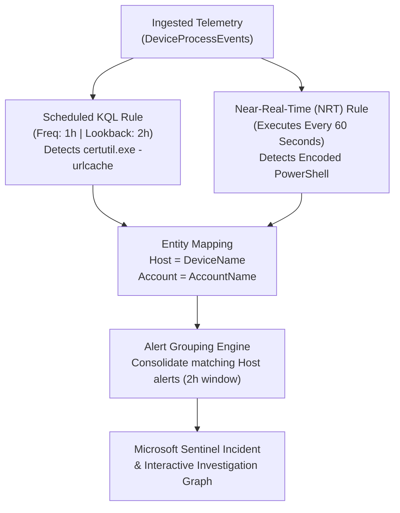

# Case Study 04: Detection Engineering — Custom Scheduled & NRT KQL Analytics Rules

| Metadata | Details |
| :--- | :--- |
| **Role Focus** | Detection Engineer / SOC Analyst |
| **MITRE ATT&CK** | `T1105` (Ingress Tool Transfer), `T1059.001` (PowerShell `-EncodedCommand`) |
| **Platforms Used** | Microsoft Sentinel Analytics Engine, Sentinel Investigation Graph, Windows 11 |
| **Automation / Query Assets** | [`simulations/simulate_suspicious_process.ps1`](../simulations/simulate_suspicious_process.ps1), [`queries/hunting_queries.kql`](../queries/hunting_queries.kql) |

---

## 🎯 1. Objective & Problem Statement

Raw telemetry stored in a SIEM has zero defensive value until Detection Engineers translate adversary tradecraft into high-fidelity **Analytics Rules**. However, poorly engineered rules suffer from two major operational flaws:
1. **Unmapped Entities:** Alerts trigger as flat text without linking the affected `Host`, `Account`, or `IP`, leaving Tier 1 analysts unable to pivot in the **Sentinel Investigation Graph**.
2. **Alert Fatigue:** Rapid script execution triggers dozens of duplicate tickets within minutes if **Alert Grouping** is not configured.

**Detection Engineering Objective:**
1. Author a **Scheduled Analytics Rule** in KQL to detect Living-off-the-Land payload staging via `certutil.exe` (`T1105`).
2. Configure **Entity Mapping** (`Host` and `Account`) and **Ingestion Latency Lookback Buffering** (1-hour frequency with a 2-hour lookback window).
3. Configure **Alert Grouping** to consolidate related alerts on the same host within a 2-hour window into a single incident.
4. Author a **Near-Real-Time (NRT) Analytics Rule** executing every **60 seconds** to detect Base64-encoded PowerShell execution (`T1059.001`).
5. Trigger the detections using [`simulate_suspicious_process.ps1`](../simulations/simulate_suspicious_process.ps1) and validate entity pivoting in the **Sentinel Investigation Graph**.

---

## 🏗️ 2. Detection Engineering Pipeline



---

## 🛠️ 3. Detection Rule Engineering & Validation

### Phase 1: Authoring the Scheduled KQL Analytics Rule (`T1105`)
In **Microsoft Sentinel** > **Configuration** > **Analytics** > **+ Create > Scheduled query rule**, I engineered the rule:

- **Name:** `SecOps - Suspicious Living-off-the-Land Ingress Tool Transfer (certutil.exe)`
- **Tactics & Techniques:** `Command and Control`, `Execution` — `T1105 (Ingress Tool Transfer)`
- **Severity:** `High`

#### Detection KQL Logic:
```kql
DeviceProcessEvents
| where TimeGenerated >= ago(1h)
| where FileName =~ "certutil.exe"
| where ProcessCommandLine has_any ("-urlcache", "-split")
| project TimeGenerated, DeviceName, AccountName, ProcessCommandLine, InitiatingProcessFileName, InitiatingProcessCommandLine, FolderPath
```

#### Entity Mapping Configuration:
| Entity Type | Identifier | Mapped KQL Column |
| :--- | :--- | :--- |
| **Host** | `HostName` | `DeviceName` |
| **Account** | `Name` | `AccountName` |

#### Scheduling & Alert Grouping (Anti-Fatigue Tuning):
- **Query Frequency:** Run every `1 Hour`
- **Lookup Data Window:** Last `2 Hours` *(prevents missed detections caused by cloud ingestion delay)*
- **Alert Grouping:** Enabled — consolidates all alerts triggered within a **2-hour window** into a single incident when the **Host** entity matches.

📸 **Evidence — Scheduled Analytics Rule Logic & Entity Mapping:**
> *Place screenshot at:* `../screenshots/case04_01_scheduled_rule_logic.png`  
> 

---

### Phase 2: Authoring a 60-Second Near-Real-Time (NRT) Rule (`T1059.001`)
For high-velocity threats where a 5-to-60 minute scheduled interval is too slow, I created a **Near-Real-Time (NRT)** rule (**+ Create > NRT query rule**):

- **Name:** `SecOps - NRT - Critical Encoded PowerShell Execution`
- **Severity:** `High`
- **Architectural Constraint Handled:** Adhered to Sentinel NRT engine requirements by querying a single table without `join` or `union` operators for sub-minute execution.

```kql
DeviceProcessEvents
| where FileName in~ ("powershell.exe", "pwsh.exe")
| where ProcessCommandLine has_any ("-enc ", "-encodedcommand ", "-ec ")
| project TimeGenerated, DeviceName, AccountName, ProcessCommandLine
```

📸 **Evidence — Near-Real-Time (NRT) Rule Configuration:**
> *Place screenshot at:* `../screenshots/case04_02_nrt_rule_config.png`  
> 

---

### Phase 3: Detection Firing & Sentinel Investigation Graph Analysis
1. Executed `.\simulations\simulate_suspicious_process.ps1` on the Windows 11 workstation to generate both `certutil.exe` and `powershell.exe -EncodedCommand` telemetry.
2. Navigated to **Microsoft Sentinel** > **Threat management** > **Incidents**.
3. Selected the triggered incident and clicked **Investigate** to launch the **Sentinel Investigation Graph**.
4. Verified that the **Incident Node** automatically linked to the **Windows 11 Host Node** and **User Account Node**, enabling one-click pivoting into *Related Alerts* and *Host Timeline Events*.

📸 **Evidence — Sentinel Investigation Graph with Mapped Host & Account Entities:**
> *Place screenshot at:* `../screenshots/case04_03_investigation_graph.png`  
> 

---

## 📊 4. Key Findings & Operational Takeaways

- **Handling Ingestion Lag in Scheduled Rules:** Cloud telemetry pipelines occasionally experience 2–10 minute ingestion delays. By configuring a **2-hour lookback window** on a **1-hour execution schedule** combined with **Alert Grouping**, we ensure zero missed events while preventing duplicate incident creation.
- **When to Use NRT vs. Scheduled Rules:** NRT rules execute every 60 seconds and are ideal for high-signal, single-table atomic indicators (like `-EncodedCommand` or `ntdsutil.exe` invocation), whereas Scheduled rules should be used for multi-table `join` correlations and baseline anomaly aggregations.

