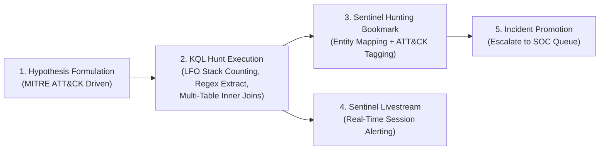

# Case Study 06: Hypothesis-Driven Threat Hunting, KQL Regex Extraction & Sentinel Livestream

| Metadata | Details |
| :--- | :--- |
| **Role Focus** | Threat Hunter / Senior SOC Analyst |
| **MITRE ATT&CK** | `T1105` (Ingress Tool Transfer), `T1059.001` (PowerShell), `T1053.005` (Scheduled Task), `T1566.001` (Spearphishing Attachment) |
| **Platforms Used** | Microsoft Sentinel Hunting, Sentinel Livestream, Hunting Bookmarks, Defender XDR Advanced Hunting |
| **Automation / Query Assets** | [`queries/hunting_queries.kql`](../queries/hunting_queries.kql), [`simulations/simulate_persistence.ps1`](../simulations/simulate_persistence.ps1), [`simulations/simulate_suspicious_process.ps1`](../simulations/simulate_suspicious_process.ps1) |

---

## 🎯 1. Objective & Problem Statement

Automated SIEM analytics rules only detect known patterns that exceed static thresholds. Stealthy adversaries blend into normal administrative noise using signed Windows binaries (`certutil.exe`, `bitsadmin.exe`, `schtasks.exe`) or multi-stage phishing delivery. **Proactive Threat Hunting** requires formulating explicit hypotheses, applying statistical stack counting (Least-Frequency-of-Occurrence), correlating across disparate tables, and preserving forensic evidence into **Hunting Bookmarks** and **Sentinel Livestream** sessions.

**Threat Hunting Objectives:**
1. Formulate and execute KQL hunts targeting **LOLBAS Ingress (`T1105`)**, **Base64 Command Obfuscation (`T1059.001`)**, **Scheduled Task Persistence (`T1053.005`)**, and **Email-to-Endpoint Execution Chains (`T1566.001`)**.
2. Preserve anomalous telemetry rows using **Microsoft Sentinel Hunting Bookmarks** mapped to MITRE ATT&CK techniques.
3. Monitor active adversary persistence and process activity in real time using **Microsoft Sentinel Livestream**.
4. Escalate confirmed hunting bookmarks into formal **Sentinel Incidents** for IR remediation.

---

## 🏗️ 2. Threat Hunting Methodology



---

## 🛠️ 3. Threat Hunting Pack & Analytical Results

### Hunt 1: Least-Frequency-of-Occurrence (LFO) Hunt for LOLBAS Binaries (`T1105`)
**Hypothesis:** *Adversaries are invoking native signed Windows transfer utilities (`certutil.exe`, `bitsadmin.exe`, `curl.exe`, `tar.exe`) with network flags to stage tools.*

```kql
let TargetBinaries = dynamic(["certutil.exe", "bitsadmin.exe", "curl.exe", "tar.exe"]);
DeviceProcessEvents
| where TimeGenerated >= ago(7d)
| where FileName in~ (TargetBinaries)
| where ProcessCommandLine has_any ("-urlcache", "-split", "/transfer", "http://", "https://")
| summarize EarliestSeen = min(TimeGenerated), LatestSeen = max(TimeGenerated), ExecCount = count() 
    by DeviceName, AccountName, FileName, ProcessCommandLine, InitiatingProcessFileName
| sort by ExecCount asc
```
- **Analytical Technique:** Sorting by `ExecCount asc` performs **Stack Counting (Least-Frequency-of-Occurrence)**, immediately surfacing rare one-off executions above repetitive background scripts.

---

### Hunt 2: Automated Regex Extraction of Base64 PowerShell Payloads (`T1059.001`)
**Hypothesis:** *Attackers are passing Base64-encoded commands to `powershell.exe` or `pwsh.exe` using varied flag abbreviations (`-e`, `-enc`, `-ec`, `-encodedcommand`).*

```kql
DeviceProcessEvents
| where TimeGenerated >= ago(7d)
| where FileName in~ ("powershell.exe", "pwsh.exe")
| where ProcessCommandLine has_any ("-e ", "-enc ", "-encodedcommand ", "-ec ")
| extend ExtractedBase64 = extract(@"-(?:e|enc|encodedcommand|ec)\s+([A-Za-z0-9+/=]+)", 1, ProcessCommandLine)
| project TimeGenerated, DeviceName, AccountName, ProcessCommandLine, ExtractedBase64, InitiatingProcessFileName
| sort by TimeGenerated desc
```
- **Analytical Technique:** Uses the KQL `extract()` regular expression function with a non-capturing alternation group `(?:e|enc|encodedcommand|ec)` to isolate the raw Base64 payload into its own `ExtractedBase64` column for rapid decoding.

---

### Hunt 3: Scheduled Task Persistence Hunting (`T1053.005`)
**Hypothesis:** *An attacker with initial execution is registering scheduled tasks via `schtasks.exe /create` to survive reboot.*

To test this hunt, I executed [`simulations/simulate_persistence.ps1`](../simulations/simulate_persistence.ps1) on the Windows 11 host (which registers a temporary task `SC200_Lab_BenignTask` and removes it after 6 seconds) and hunted for the telemetry:

```kql
DeviceProcessEvents
| where TimeGenerated > ago(24h)
| where FileName =~ "schtasks.exe"
| where ProcessCommandLine has "/create"
| project TimeGenerated, DeviceName, AccountName, ProcessCommandLine, InitiatingProcessFileName
| sort by TimeGenerated desc
```

📸 **Evidence — KQL Hunt Results (LOLBAS, Encoded PowerShell & Persistence):**
> *Place screenshot at:* `../screenshots/case06_01_kql_hunting_results.png`  
> 

---

### Hunt 4: Multi-Table Correlation — Email Attachment Delivery to Endpoint Process Execution (`T1566.001`)
**Hypothesis:** *A user received an email attachment (`xlsm`, `iso`, `vhd`, `exe`, `zip`) and executed a suspicious process on their workstation within 2 hours of email delivery.*

```kql
EmailAttachmentInfo
| where TimeGenerated >= ago(3d)
| where FileType in~ ("xlsm", "iso", "vhd", "exe", "scr", "zip")
| join kind=inner (
    EmailEvents
    | where TimeGenerated >= ago(3d)
    | project NetworkMessageId, RecipientEmailAddress, Subject, SenderFromAddress
) on NetworkMessageId
| join kind=inner (
    DeviceProcessEvents
    | where TimeGenerated >= ago(3d)
    | project ProcessTime = TimeGenerated, DeviceName, AccountUpn = InitiatingProcessAccountUpn, FileName, ProcessCommandLine
) on $left.RecipientEmailAddress == $right.AccountUpn
| where ProcessTime between (TimeGenerated .. (TimeGenerated + 2h))
| project TimeGenerated, ProcessTime, RecipientEmailAddress, DeviceName, Subject, FileName, ProcessCommandLine
| sort by ProcessTime desc
```

---

### Phase 5: Preserving Evidence with Sentinel Hunting Bookmarks & Promoting to Incident
1. Selected the anomalous `certutil.exe` telemetry row in **Microsoft Sentinel > Logs** and clicked **Add bookmark**.
2. Mapped the **Host** (`DeviceName`) and **Account** (`AccountName`) entities, tagged **`Command and Control — T1105`**, and documented analytical notes.
3. Navigated to **Threat management** > **Hunting** > **Bookmarks**, selected **`Investigate - Suspicious certutil LOLBAS Ingress`**, and clicked **Create Incident** (`PROMOTED HUNT: Living-off-the-Land Ingress Tool Transfer on Host`).

📸 **Evidence — Sentinel Hunting Bookmark & Incident Promotion:**
> *Place screenshot at:* `../screenshots/case06_02_hunting_bookmark_promotion.png`  
> 

---

### Phase 6: Real-Time Adversary Tracking via Sentinel Livestream
1. Added the LOLBAS/Encoded PowerShell hunting query to **Sentinel Livestream** (**Hunting > Queries > Add to livestream**) with desktop notifications enabled.
2. Re-executed `simulate_suspicious_process.ps1` on the endpoint and verified real-time streaming capture inside the active Livestream console.

📸 **Evidence — Microsoft Sentinel Livestream Active Session:**
> *Place screenshot at:* `../screenshots/case06_03_sentinel_livestream.png`  
> 

---

## 📊 4. Key Findings & Operational Takeaways

- **Why Bookmarks Matter in Collaborative SOCs:** Raw KQL results disappear when a tab is closed. **Sentinel Hunting Bookmarks** persist the exact log row, entity mappings, and analyst annotations into the `HuntingBookmark` table so they can be attached to existing incidents or promoted into new incidents with full Investigation Graph support.
- **Temporal Window Joins (`between`):** When joining high-volume tables like `EmailEvents` and `DeviceProcessEvents`, constraining the join with `where ProcessTime between (TimeGenerated .. (TimeGenerated + 2h))` eliminates false-positive correlations from unrelated historical emails.

