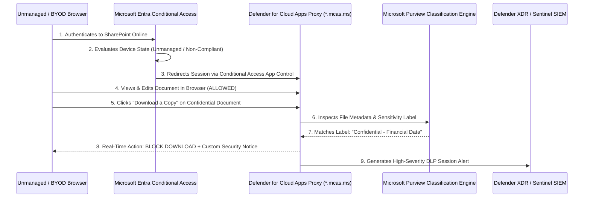

# Case Study 07: Cloud SaaS DLP — Microsoft Purview Sensitivity Labels & MDCA Real-Time Session Control

| Metadata | Details |
| :--- | :--- |
| **Role Focus** | Cloud Security Engineer / DLP & CASB Analyst |
| **MITRE ATT&CK** | `T1530` (Data from Cloud Storage Object), `T1213.002` (Data from Information Repositories: SharePoint) |
| **Platforms Used** | Microsoft Purview Information Protection, Microsoft Entra ID Conditional Access, Microsoft Defender for Cloud Apps (MDCA) |

---

## 🎯 1. Objective & Problem Statement

In modern hybrid workforces, employees and contractors frequently access corporate SaaS platforms (SharePoint Online, OneDrive for Business) from personal or unmanaged (BYOD) machines. Completely blocking browser access harms productivity, but allowing unrestricted access permits sensitive financial or customer files to be downloaded onto untrusted endpoints where EDR sensors are absent.

**Cloud Security Engineering Objective:**
1. Author and publish a **Sensitivity Label** (`Confidential - Financial Data`) in **Microsoft Purview Information Protection**.
2. Configure a **Microsoft Entra ID Conditional Access** policy that identifies unmanaged/BYOD browser sessions targeting SharePoint Online and routes them through **Conditional Access App Control**.
3. Engineer a **Real-Time Session Policy** in **Microsoft Defender for Cloud Apps (MDCA)** that inspects file downloads on the fly—permitting users to view and edit files in the browser (`*.mcas.ms`) while **blocking downloads** of documents carrying the `Confidential - Financial Data` label.
4. Validate the reverse-proxy enforcement in an unmanaged browser session and investigate the resulting DLP block telemetry in the MDCA Activity Log and Defender XDR.

---

## 🏗️ 2. Zero-Trust CASB & DLP Session Architecture

---

## 🛠️ 3. Implementation & Engineering Procedure

### Phase 1: Creating & Publishing the Purview Sensitivity Label
1. In the **Microsoft Purview portal** (`https://purview.microsoft.com` > **Information Protection** > **Labels**), created the label:
   - **Name / Display Name:** `Confidential - Financial Data` (`Confidential - Financial`)
   - **Scope:** `Items (files and emails)`
2. Published the label via **Label policies** so documents in SharePoint Online and OneDrive can be classified and evaluated by the Data Classification Service.

📸 **Evidence — Microsoft Purview Sensitivity Label Published:**
> *Place screenshot at:* `../screenshots/case07_01_purview_sensitivity_label.png`  
> 

---

### Phase 2: Routing Unmanaged Sessions via Entra Conditional Access
In the **Microsoft Entra admin center** (`https://entra.microsoft.com` > **Protection** > **Conditional Access**), I configured the policy **`SecOps - Route Cloud Apps to MDCA on Unmanaged Devices`**:
- **Target Resources:** `Office 365 SharePoint Online`
- **Conditions:**
  - **Client apps:** `Browser`
  - **Filter for devices:** Excluded Entra hybrid-joined / Intune compliant corporate devices so enforcement targets unmanaged/BYOD sessions.
- **Session Control:** Enabled **Use Conditional Access App Control** → **Use custom policy**.

📸 **Evidence — Entra ID Conditional Access App Control Policy:**
> *Place screenshot at:* `../screenshots/case07_02_entra_conditional_access_mdca.png`  
> 

---

### Phase 3: Engineering the Real-Time Session Policy in Defender for Cloud Apps
In **Microsoft Defender XDR** (`https://security.microsoft.com` > **Cloud apps** > **Policies** > **Policy management**), I created the **Session Policy**:
- **Policy Name:** `Block Download of Confidential Labeled Files on BYOD`
- **Severity / Category:** `High` / `DLP`
- **Session Control Type:** `Control file download (with inspection)`
- **Activity Filter:** `App Equals Microsoft SharePoint Online, OneDrive for Business`
- **File Filter:** `Sensitivity label Equals Confidential - Financial Data`
- **Inspection Method:** `Data Classification Service`
- **Action:** **Block** with customized user notification:
  > *"SECURITY NOTICE: Downloading Confidential files to unmanaged personal devices is prohibited by corporate security policy. You may view and edit this file in your browser."*

📸 **Evidence — Defender for Cloud Apps Real-Time Session Policy:**
> *Place screenshot at:* `../screenshots/case07_03_mdca_session_policy.png`  
> 

---

### Phase 4: End-to-End Reverse Proxy Validation & SOC Alert Triage
1. Authenticated to SharePoint Online from an unmanaged browser session.
2. Verified that the session URL dynamically rewrote to the MDCA reverse proxy domain (`*.sharepoint.com.mcas.ms`) and displayed the monitoring banner.
3. Opened a document labeled `Confidential - Financial` in Office Online (confirmed in-browser read/write worked seamlessly) and attempted **File > Save As > Download a Copy**.
4. Confirmed that MDCA intercepted the HTTP response in real time, blocked the file transfer, displayed the custom corporate DLP notice, and logged a `Blocked` `Download file` event in the **Cloud Apps Activity Log**.

📸 **Evidence — Real-Time Download Block (`*.mcas.ms`) & Activity Log Telemetry:**
> *Place screenshot at:* `../screenshots/case07_04_mcas_download_blocked.png`  
> 

---

## 📊 4. Key Findings & Operational Takeaways

- **Granular Zero-Trust Session Control vs. Binary Block:** Traditional Conditional Access policies only offer a binary choice: allow full access or block sign-in completely. Integrating **Entra Conditional Access** with **MDCA Session Policies** and **Purview Sensitivity Labels** enables fine-grained, content-aware governance: external contractors or BYOD users can collaborate on documents in the browser while exfiltration of `Confidential` labeled files is blocked at the proxy layer.

