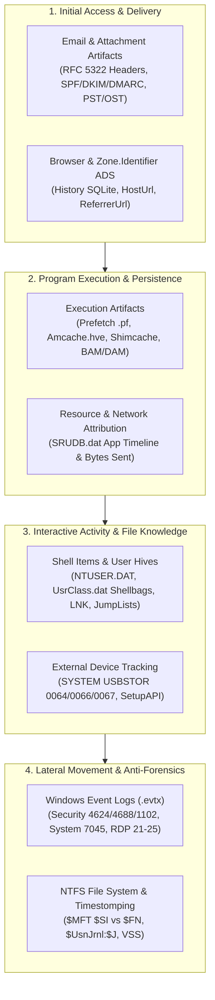

# 🔎 Windows Digital Forensics & Incident Response (DFIR) Playbooks

[](#)
[](#)
[](#)
[](#)

> **Author:** Muftaw Wahab Ayinla (MSc Cybersecurity)  
> **Forensic Focus:** Windows Endpoint Triage, Program Execution Reconstruction, Registry Hive & Transaction Log Analysis, Lateral Movement Event Log Correlation, NTFS File System Forensics, and Browser/Cloud Exfiltration Analysis.

---

## 📌 Executive Overview

When an enterprise Windows host is compromised, anti-forensic cleanup (such as deleting dropped binaries or clearing browser history) rarely removes the underlying operating system telemetry. This repository contains **5 structured Windows Digital Forensics (DFIR) investigation playbooks and artifact reference guides** used to reconstruct adversary activity across disk, registry, event logs, and user profiles.

---

## 🗺️ Windows Forensic Artifact Correlation Matrix



---

## 📂 Forensic Investigation Playbooks (`investigations/`)

| # | Investigation Playbook | Primary Forensic Artifacts Analyzed | Core Forensic Tooling |
| :---: | :--- | :--- | :--- |
| **01** | **[Program Execution, Persistence & Resource Usage Reconstruction](./investigations/01_Program_Execution_and_Persistence_Forensics.md)** | Windows Prefetch (`v26`/`v30`), `Amcache.hve` (`InventoryApplicationFile`), `AppCompatCache` (Shimcache), `BAM`/`DAM`, and `SRUDB.dat` (SRUM) | `PECmd.exe`, `AmcacheParser.exe`, `AppCompatCacheParser.exe`, `SrumECmd.exe` |
| **02** | **[Windows Event Log Correlation & Lateral Movement Triage](./investigations/02_Event_Log_and_Lateral_Movement_Investigation.md)** | `Security.evtx` (`4624`, `4625`, `4648`, `4672`, `4688`, `1102`), `System.evtx` (`7045`), TerminalServices RDP (`21`, `22`, `24`, `25`, `1149`), PowerShell (`4104`) | `EvtxECmd.exe`, Timeline Explorer, Event Viewer |
| **03** | **[Registry Forensics, Dirty Hive Replay, User Activity & USB Tracking](./investigations/03_Registry_Hives_USB_and_User_Activity.md)** | Dirty Registry Transaction Logs (`.LOG1`/`.LOG2`), `Shellbags` (`UsrClass.dat`), `.LNK` Shortcut Files & Volume Serials, Jump Lists (`DestList`), and `USBSTOR` (`0064`/`0066`/`0067`) | `Registry Explorer`, `SBECmd.exe`, `LECmd.exe`, `JLECmd.exe` |
| **04** | **[NTFS File System Forensics, Timestomping Detection & Deleted Data Recovery](./investigations/04_NTFS_MFT_UsnJrnl_and_Timestomp_Analysis.md)** | `$MFT` (`$STANDARD_INFORMATION` vs. `$FILE_NAME` MACB drift), Resident vs. Non-Resident `$DATA`, `$UsnJrnl:$J`, Recycle Bin (`$I` / `$R`), Volume Shadow Copies (VSS) | `MFTECmd.exe`, `RBCmd.exe`, Autopsy / FTK Imager |
| **05** | **[Browser Forensics, Cloud Storage Sync & Email Header Investigation](./investigations/05_Browser_Cloud_Storage_and_Email_Forensics.md)** | Chromium/Firefox SQLite (`History`, `urls`, `downloads`, `.sqlite-wal`), `:Zone.Identifier` ADS, OneDrive (`.odl`, `SyncEngineDatabase.db`), RFC 5322 Email Headers | `DB Browser for SQLite`, `SQLECmd.exe`, PowerShell ADS Inspector |

---

## 🛠️ Repository Structure

```text
windows-dfir-forensics-labs/
├── README.md
├── investigations/
│   ├── 01_Program_Execution_and_Persistence_Forensics.md
│   ├── 02_Event_Log_and_Lateral_Movement_Investigation.md
│   ├── 03_Registry_Hives_USB_and_User_Activity.md
│   ├── 04_NTFS_MFT_UsnJrnl_and_Timestomp_Analysis.md
│   └── 05_Browser_Cloud_Storage_and_Email_Forensics.md
└── screenshots/
    └── README.md                            # Evidence directory for Zimmerman Tools / Autopsy / Volatility screenshots
```

